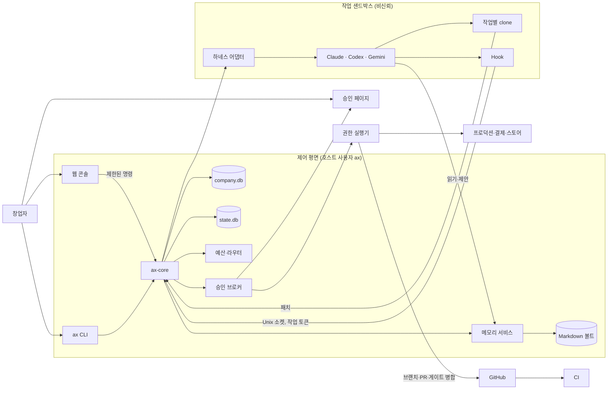
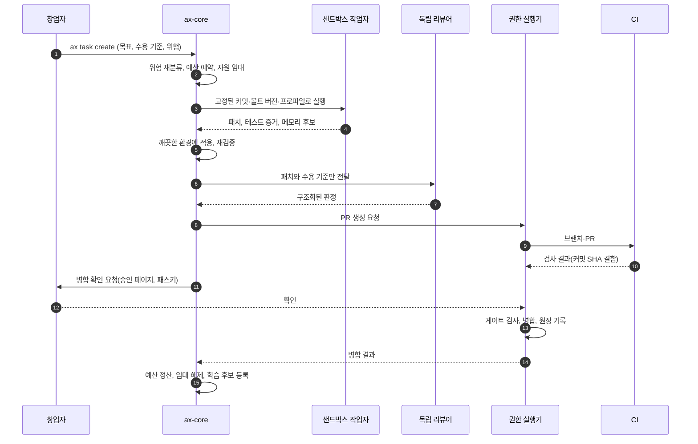

# 01. 아키텍처

**결론: AX는 여러 서비스를 계속 개발하고 운영하기 위한 AI Native 기반이다. 특정 서비스의 출시 도구가 아니다. 로컬 단일 머신에서 시작하는 제어 평면이며, 에이전트는 신뢰하지 않는 작업자이고, 병합과 프로덕션 권한은 에이전트 밖에 둔다.**

## 1. 범위

Type A~D는 앞으로 만들 서비스의 종류다. 이 설계에서는 확장 요구 조건으로 다룬다([13](13-service-lifecycle.md)).

| 구분 | 내용 |
|---|---|
| 포함 (Phase 1) | `ax` CLI, 작업 상태 머신, 메모리 볼트, Hook, 승인 브로커, 역할 5종, CI 게이트, 콘솔 최소판 |
| 포함 (P2~P3) | 생애주기, 서비스 팩 계약, 기준 서비스, 변경 전파, 다중 서비스 운영, Dreaming, 기업 기능 모듈, 대시보드 |
| 서비스 시작 시 | 유형별 팩 구현, 마케팅·지원·분석의 실제 연결 |
| 제외 | 자체 모델 학습, 다중 사용자 협업, 다중 머신 클러스터, 범용 워크플로 엔진 |

Phase 1 역할은 PM, 웹 FE/BE, QA, 서비스 보안, AgentShield 감사이다.

## 2. 품질 목표

| ID | 목표 | 측정 |
|---|---|---|
| NFR-01 | 에이전트 프로세스는 프로덕션 자격증명을 가지지 않는다. | 샌드박스 안에서 카나리 변수와 파일 조회가 실패한다. |
| NFR-02 | 프로세스가 강제 종료되어도 완료된 전이를 잃지 않는다. | `kill -9` 시험 100회에서 손실 0건 |
| NFR-03 | 같은 명령을 다시 실행해도 부작용이 한 번만 생긴다. | 멱등 키 재전송 시험 |
| NFR-04 | 일상 Hook은 p95 300ms, 파일 검사는 p95 5초 안에 끝난다. | Hook 지표 |
| NFR-05 | 메모리 검색은 1만 건에서 p95 200ms다. | 벤치마크 |
| NFR-06 | 예산 하드 상한 초과액은 실행 중 호출 1건 이하이다. | 예산 원장 |
| NFR-07 | 플랫폼 관리 시간은 주 3시간 이하이다. | 주간 기록 |
| NFR-08 | 기준 서비스의 배포를 10분 안에 이전 산출물로 되돌린다. | 되돌리기 시험 10회 |

수치는 **제안**이다. Phase 1에서 측정한 뒤 확정한다.

## 3. 구성 요소



| 요소 | 책임 | 하지 않는 일 |
|---|---|---|
| `ax-core` | 상태 전이, 이벤트 기록, 임대, 스케줄링 | 모델 응답 해석으로 권한 부여 |
| 하네스 어댑터 | CLI 실행, 이벤트 표준화, 종료 처리 | 승인 판단 |
| 메모리 서비스 | 검증, 저장, 검색, 버전 교체 | 지시 파일 직접 수정 |
| 웹 콘솔 | 조회, 대시보드, 시작·중지 요청 | 승인, 정책 변경, DB 직접 접근 |
| 승인 브로커 | 해시 결합 승인, 만료 | 작업 실행, 소비 확정 |
| 권한 실행기 | 서명 재검증, 1회 소비, 병합 게이트, 허용 작업 실행 | 임의 셸 실행 |
| CI | 독립 재검증, 결과 제공 | 에이전트의 자기 보고 신뢰 |

## 4. 신뢰 경계

| 등급 | 대상 | 규칙 |
|---|---|---|
| T0 | 창업자, 승인 기기, 정책 파일 | 정책 변경은 패스키를 거친 병합 게이트로만 한다. |
| T1 | `ax-core`, 실행기, CI | 코드 리뷰와 서명된 릴리스를 쓴다. |
| T2 | 에이전트, Hook 프로세스, 작업별 clone | 출력은 모두 검증할 입력이다. |
| T3 | 웹, 고객 문의, 외부 이슈, 새 의존성, 제3자 Skill | 인용 데이터로만 전달한다. |

잠금 파일에 고정되고 이미 병합된 의존성은 T2다. 그렇지 않으면 모든 코드 작업이 오염 처리된다. 새 의존성은 R2 검토로 들어온다.
T3 데이터를 읽은 작업은 `tainted=true`가 된다. 이 표시는 해당 작업의 하위 작업과 메모리에 이어진다.
`tainted` 작업은 네트워크 쓰기, 고위험 도구, 메모리 승격 증거 제공을 할 수 없다.
표시는 지울 수 없다. 사람이 확인한 산출물이나 허용된 구조화 필드만 입력으로 받는 새 작업을 만든다. 이 작업은 `parent_id`를 갖지 않고 원 작업을 참조로만 남긴다. 부모가 오염되면 새 하위 작업도 오염된다. DB 트리거가 이를 강제한다. 웹을 쓰는 PM의 `task.yaml`은 창업자가 `ax task ready`에서 확인한 뒤 새 작업이 된다.

## 5. 샌드박스

아래는 무인 실행 규격이다. 현재의 감독 모드는 [12](12-supervised-mode.md)를 따른다.

- 기본은 `bwrap`이다. 로컬에서 기본 실행을 확인했다(확인됨). 네트워크 차단과 환경 변수 격리는 로컬에서 확인했다([기록](evidence/2026-11-24-local-checks.md)). 나머지는 W0-2에서 시험한다.
- 루트는 읽기 전용이다. 작업별 clone, 작업별 `/tmp`, 작업별 캐시만 쓴다.
- `~/.ssh`, `~/.aws`, `~/.config/gh`, 볼트 원본, `state.db`는 마운트하지 않는다.
- 샌드박스의 유일한 출구는 `proxy.sock`이다. 안쪽 전달기가 loopback TCP를 이 소켓에 잇는다. 이 경로는 로컬에서 확인했다.
- `CONNECT` 터널은 TLS 안을 보지 못한다. 그래서 도메인만 제한하고 메서드는 제한하지 못한다. `CONNECT`는 쓰지 않는다.
- 패키지는 호스트의 읽기 캐시가 GET만 중계한다. 주소는 **기준 커밋**의 잠금 파일에 있는 이름과 버전으로 제한한다. 작업이 바꾼 잠금 파일은 쓰지 않는다. 임의 경로에 데이터를 실을 수 없게 한다.
- 모델 API는 호스트 중계기가 TLS를 다시 맺는다. 허용 경로와 본문 크기를 검사한다.
- 웹 검색은 호스트 도구가 대신 실행한다. 질의 문자열도 유출 통로다. 그래서 비밀과 고객 데이터가 있는 작업에는 주지 않는다.
- 모델 인증 정보는 중계기가 주입한다. 하네스가 이를 지원하지 않으면 범위와 한도를 줄인 전용 키를 쓴다. 이 경우 키는 에이전트에 노출된다고 가정한다.
- `bwrap`을 쓸 수 없으면 Docker를 쓴다. 둘 다 실패하면 실행하지 않는다.
- Docker 소켓은 샌드박스에 넘기지 않는다.

git은 공격면이다. Worktree의 `.git`은 주 저장소를 가리키므로 쓰기 가능한 공용 `.git`을 노출하지 않는다.
샌드박스에는 독립 `clone`을 준다. 코어는 그 결과를 패치로 받아 제어 평면의 깨끗한 Worktree에 적용한다. 적용 때 Hook과 필터를 끈다(`core.hooksPath=/dev/null`).

## 6. 저장소와 디렉터리

```text
ax/
  apps/cli/  apps/approval-web/
  packages/core/  packages/memory/  packages/policy/
  packages/adapters/{claude,codex,gemini}/  packages/executor/
  packages/capabilities/*/  packs/*/  reference/{stateless,stateful}/
  agents/*.yaml   skills/*/SKILL.md   profiles/*.json
  policies/*.yaml   docs/
~/.local/share/ax/          # 권한 0700
  state.db  artifacts/<sha256>  vault/versions/<id>/  vault/current -> versions/<id>
  quarantine/  backups/
```

실행 데이터는 저장소에 커밋하지 않는다.

## 7. 기술 선택

| 영역 | 선택 | 바꿀 조건 |
|---|---|---|
| 언어 | TypeScript, 현재 Node LTS, pnpm workspace | 없음 |
| 상태 | SQLite WAL, 단일 쓰기 프로세스 | 쓰기 머신이 2대가 될 때 Postgres |
| 검색 | SQLite FTS5 | 검색 재현율 시험에서 80% 미만일 때 임베딩 |
| 지식 | Markdown + YAML frontmatter | 없음 |
| 프로세스 | 사용자 systemd 서비스, 작업별 자식 프로세스 | 원격 실행이 필요할 때 |
| 계약 | JSON Schema 2020-12 | 없음 |

한국어 FTS는 기본 토크나이저로 조사 변형을 놓친다. `trigram` 토크나이저를 쓴다. 3글자 미만 검색어는 `LIKE`로 처리한다.

## 8. 핵심 흐름: 기능 1건



## 9. 위험도

| 등급 | 예 | 요구 |
|---|---|---|
| R0 | 문서, 로컬 분석 | 자동 검사 |
| R1 | 일반 기능 코드 | CI + 독립 리뷰 1 |
| R2 | 인증, 권한, 결제 코드, DB 스키마, CI, Hook, 정책 | CI + 이기종 리뷰 2 + 창업자 승인 |
| R3 | 프로덕션 변경, 외부 발송, 지출, 스토어 제출, 공개 | R2 + 권한 실행기 + 1회용 승인 |

위험도는 경로 규칙, 변경 내용, 요청 도구 중 가장 높은 값이다. 에이전트는 올릴 수만 있고 내릴 수 없다.
