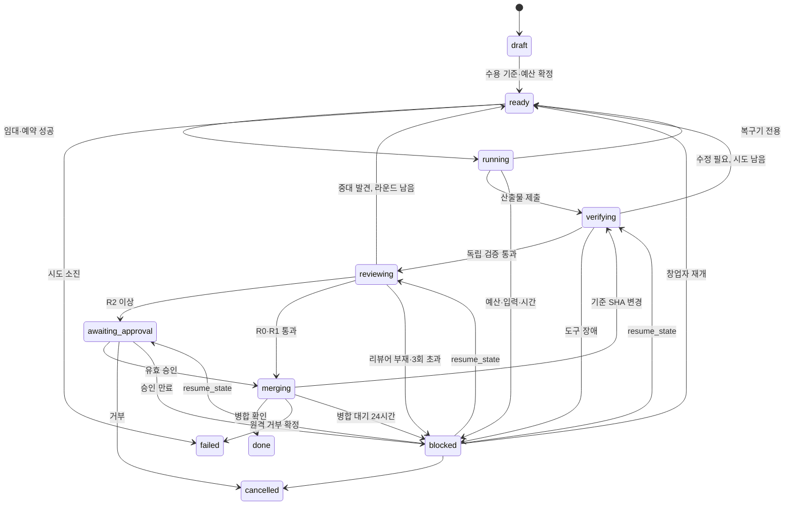

# 02. 오케스트레이션

**결론: 코드가 상태를 전이한다. 모델은 제안과 산출물만 낸다.**

## 1. 작업 상태



`blocked`는 `resume_state`를 가진다. 재개 때 그 상태의 진입 조건을 다시 검사한다.
`draft`, `ready`, `running`, `verifying`, `reviewing`, `blocked`에서 창업자가 `cancelled`로 바꿀 수 있다.
P1에서는 R0와 R1도 창업자가 확인해야 게이트가 병합한다. 작업은 `merging`에서 기다린다. 자동 병합은 P2 뒤 별도 ADR로 연다.
`merging`에서는 먼저 원격 병합 여부를 확인한다. `done`, `failed`, `cancelled`는 끝 상태다.

표준 루프와의 대응은 다음과 같다.

| 루프 | 상태 | 산출물 |
|---|---|---|
| plan | `draft` | 수용 기준, 위험도 |
| test, implement | `running` | 실패하는 테스트, 패치 |
| verify | `verifying` | 깨끗한 환경의 테스트 결과 |
| review | `reviewing` | `review.schema.json` 판정 |
| remember, improve | `done` 이후 비동기 | 메모리 후보 |

초안은 review를 verify보다 먼저 둔다. 이 설계는 결정론적 검증을 먼저 한다. 실패할 코드를 비싼 모델로 리뷰하지 않기 위해서다.

## 2. 전이 규칙

전이는 한 SQLite 트랜잭션에서 다음을 수행한다.

1. `UPDATE task ... WHERE id=? AND version=? AND state=?`
2. `event` 추가
3. 외부 작업이 있으면 같은 트랜잭션에서 `outbox` 행 추가

허용 전이는 `task_transition` 표에 있고 DB 트리거가 나머지를 거부한다.
DB 트리거는 코드 실수를 막는다. DB 소유자는 트리거를 지울 수 있으므로 공격자 경계가 아니다.
코어는 연결마다 `foreign_keys=ON`을 설정하고 읽어 확인한다. `INSERT OR REPLACE`와 `UPDATE OR REPLACE`는 코드 검사에서 금지한다.
`task`의 `version`은 모든 전이에서 1씩 늘린다.
갱신 행이 0이면 종료 코드 4다. 외부 작업은 outbox 처리기가 최소 1회 실행하고 멱등 키로 중복을 막는다.
이벤트 해시는 `SHA256(prev_hash || canonical_json(type, actor, task_id, payload, at))`이다. 해시 사슬은 우발적 손상을 찾는다. DB 소유자의 위조를 막으려면 일별 끝 해시를 외부 저장소에 복사한다.

## 3. 명령과 오류

| 명령 | 선행 상태 | 결과 |
|---|---|---|
| `ax task create --file task.yaml` | 없음 | `draft` |
| `ax task ready <id>` | `draft` | `ready` |
| `ax run [--task <id>]` | `ready` | `running` |
| `ax task resume <id>` | `blocked` | 진입 조건 검사 후 전이 |
| `ax task cancel <id>` | 끝 상태와 `merging` 제외 | `cancelled` |
| `ax task stop <id>` | `running` | 프로세스 종료 확인 후 `blocked`, `resume_state=ready` |
| `ax console open` | 모두 | 60초짜리 1회 주소 |
| `ax time confirm` | 모두 | 창업자 시간 확정 |
| `ax status`, `ax events <id>` | 모두 | 읽기 전용 |

| 오류 | 재시도 | 처리 |
|---|---|---|
| `AX-E-CONFLICT` | 예 | 다시 읽고 최대 3회 |
| `AX-E-RATE` | 예 | 서버 지정 시간 또는 1, 2, 4, 8분에 ±20% |
| `AX-E-NETWORK` | 예 | 3회 |
| `AX-E-BUDGET`, `AX-E-POLICY` | 아니오 | `blocked` |
| `AX-E-SANDBOX` | 아니오 | 실행 거부, 경보 |
| `AX-E-REVIEWER` | 아니오 | `blocked` |
| `AX-E-STALE-BASE` | 1회 | 재적용 후 검증부터 |

구현 시도는 최대 3회다. 리뷰 라운드는 최대 3회다. 두 값은 따로 센다.

## 4. 격리와 임대

| 자원 | 격리 방법 | 임대 키 |
|---|---|---|
| 코드 | 작업별 독립 clone | 불필요 |
| 포트 | 작업별 네트워크 네임스페이스 | 불필요 |
| 개발 DB | 작업별 컨테이너와 볼륨 | `db:<task>` |
| 마이그레이션 번호 | 프로젝트 직렬화 | `migration:<project>` |
| 잠금 파일, 공용 설정 | 경로 겹침 시 직렬화 | `path:<project>:<glob>` |
| 시뮬레이터, 실기기 | 장비 단위 | `device:<id>` |
| 병합 | 프로젝트당 1건 | `merge:<project>` |

임대 획득은 `BEGIN IMMEDIATE` 안에서 두 문장이다. 동시 요청 50건에서 1건만 성공함을 [시험](evidence/check_concurrency.py)했다.

```sql
INSERT INTO fence_counter VALUES(:r,1) ON CONFLICT(resource) DO UPDATE SET value=value+1
 WHERE NOT EXISTS(SELECT 1 FROM lease WHERE resource=:r AND expires_at>:now); -- 0행이면 실패
INSERT INTO lease SELECT :r,:t,value,:now+60000 FROM fence_counter WHERE resource=:r
 ON CONFLICT(resource) DO UPDATE SET task_id=excluded.task_id,fence=excluded.fence,expires_at=excluded.expires_at
 WHERE lease.expires_at<=:now;
```

해제는 행 삭제다. `fence_counter`는 지우지 않는다.
임대는 60초이고 20초마다 갱신한다. 여러 개를 얻을 때는 키 사전순으로 얻는다. 그래서 교착이 없다.
갱신에 실패한 작업은 쓰기를 멈춘다. 쓰기를 받는 쪽은 `fence`가 최신인지 검사한다. 펜싱을 지원하지 않는 외부 자원은 만료만으로 다른 작업에 넘기지 않고 프로세스 종료를 확인한다.
구독 모드의 동시 작업은 1개다. API 모드에서는 2개로 시작한다(**제안**). 로컬은 16코어, 메모리 15GiB다(확인됨). 작업 상한 4GiB를 감안했다.

## 5. 복구

시작할 때 다음 순서로 실행한다.

1. DB `quick_check`와 이벤트 사슬을 검사한다. 실패하면 읽기 전용으로 시작한다.
2. 볼트 링크를 DB와 맞춘다.
3. 살아 있지 않은 자식의 `running` 작업을 `ready`로 돌리고 시도를 1 늘린다. PID 재사용에 속지 않게 시작 시각도 대조한다.
   `verifying`과 `reviewing`의 실행은 부작용이 없다. 같은 상태에서 새 실행 ID로 다시 시작한다.
   코어가 죽으면 `--die-with-parent`가 샌드박스를 끝낸다. 남은 cgroup은 먼저 제거한다.
4. 만료 승인과 임대를 정리한다.
5. outbox를 재개한다.
6. `merging` 작업의 원격 상태를 조회한다.

3번의 `running → ready`는 복구기만 쓰는 전이다.

## 6. 예산과 모델 라우팅

작업 잔액은 `정산액 + 미정산 예약액`으로 센다. 예약은 잔액 조건이 있는 `INSERT ... SELECT` 한 문장이다. 동시 100건에서 상한만큼 10건만 성공함을 시험했다.
하루와 월 상한도 같은 트랜잭션에서 검사한다.
호출 전에 최악 비용을 예약하고 응답 뒤 정산한다. 실제 사용량을 모르면 예약액 전부를 정산한다.
구독형 CLI는 호출당 비용이 없다. 이때는 `시간`, `턴`, `한도 사용률`을 함께 제한한다.
한도 사용률은 같은 `resets_at` 구간에서 관측한 최댓값을 쓴다. 여러 세션이 한 파일에 쓰면 오래된 값이 새 값을 덮는다(2026-11-24에 93%가 81%로 바뀐 것을 관측).
마지막 관측이 10분을 넘으면 새 작업을 시작하지 않는다. 환산 비용은 추정으로 표시한다.

| 사용률 | 동작 |
|---|---|
| 60% | 알림 |
| 80% | 새 R0 작업 중지, 경량 모델 우선 |
| 95% | 새 작업 중지, 실행 작업은 마무리만 |
| 100% | 호출 거부, `blocked` |

현재는 구독 모드다([ADR-0007](adr/0007-subscription-agents.md)). LLM API 예산은 0이고 고정비는 월 20달러다.
작업은 45분, 60턴으로 제한한다(**제안**). 위 표의 사용률은 5시간과 주간 한도 중 높은 값이다.
사용률을 읽을 수 없는 도구는 시간과 턴만 제한한다. 달러 예약 원장(O-05, NFR-06)은 API를 켤 때 적용한다.

| 작업 | 등급 | 규칙 |
|---|---|---|
| 분류, 요약, 추출 | `small` | 스키마 실패 2회면 `standard` |
| 일반 구현, 테스트 | `standard` | 같은 실패 2회면 `frontier` |
| 설계, R2 구현, 보안 리뷰 | `frontier` | 하향 금지 |

등급과 모델 ID는 설정 파일에서 잇는다. 문서와 코드에 모델 ID를 고정하지 않는다.
외부 모델에 코드를 보내기 전에 프로젝트의 데이터 정책에서 공급자를 허용했는지 검사한다.

## 7. 하네스 어댑터

```ts
interface HarnessAdapter {
  probe(): Promise<{version: string; features: Set<Feature>}>;
  start(spec: RunSpec, signal: AbortSignal): AsyncIterable<HarnessEvent>;
}
type HarnessEvent =
  | {type: 'session'; id: string} | {type: 'tool'; toolUseId: string; name: string; phase: 'start' | 'end'; ok?: boolean}
  | {type: 'usage'; input: number; output: number; cached: number; costMicroUsd?: number}
  | {type: 'result'; ok: boolean; output: unknown};
```

- `probe` 결과가 검증된 버전 범위를 벗어나면 R2 이상 작업을 거부한다.
- Hook이 없는 하네스는 R0와 R1만 실행한다. 샌드박스와 CI는 같다.
- Claude는 `-p`, 구조화 출력, `--strict-mcp-config`, `--max-budget-usd`를 쓴다(플래그 존재 확인됨).
- `--setting-sources ""`와 `--settings '<인라인 JSON>'`을 함께 쓴다. 저장소 설정은 비신뢰 입력이다. 이 모드는 `CLAUDE.md`를 읽지 않는다(실측). 코어가 기준 커밋의 지시 파일을 검증해 시스템 프롬프트로 주입한다. 작업이 바꾼 지시 파일은 쓰지 않는다.
- `--bare`는 Hook을 건너뛰므로 금지한다(도움말에서 확인됨).
- Codex 리뷰는 `codex exec --json --output-schema <파일> --ephemeral --ignore-user-config -s read-only`를 쓴다(0.171.0에서 플래그 존재 확인됨, 동작 미시험).
- 우회 플래그(`--dangerously-*`, `--yolo`, `--skip-trust`)는 어댑터의 인자 검사에서 거부한다.
- 취소하면 SIGTERM, 10초 뒤 프로세스 그룹 전체에 SIGKILL을 보낸다.

## 8. 수용 기준

- O-01: 허용 목록에 없는 모든 상태 쌍의 전이가 거부된다.
- O-02: 각 전이 직전과 직후에 강제 종료해도 이벤트와 상태가 일치한다.
- O-03: outbox를 두 번 처리해도 PR이 하나다.
- O-04: 오래된 `fence`의 쓰기가 거부된다.
- O-05: 예약 동시 요청이 상한을 넘지 않는다.
- O-06: 기준 브랜치가 바뀌면 이전 CI와 리뷰 결과가 무효가 된다.
- O-07: `REPLACE` 구문으로 이벤트, 승인, 예산, 오염 표시를 바꿀 수 없다.
