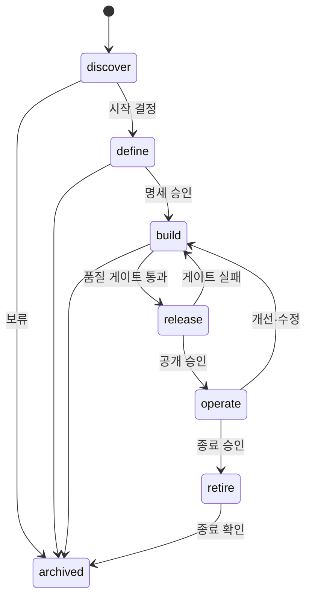

# 13. 서비스 생애주기와 서비스 팩

**결론: AX의 산출물은 특정 서비스가 아니다. Type A~D 서비스를 같은 방식으로 반복해서 만들고 운영하는 능력이다.**

## 1. 방향

- AX는 앞으로 이어질 여러 서비스를 위한 기반이다. 플랫폼 구축은 특정 서비스의 출시 일정에 묶이지 않는다.
- Type A~D는 현재의 개발 대상이 아니다. 플랫폼이 감당해야 할 **요구 조건**이다.
- 서비스의 수요와 매출은 플랫폼의 일정과 중단 기준이 아니다. 이를 관리하고 판단하는 능력은 플랫폼의 기능이다([14](14-business-modules.md)).

| 목표 | 설계에서의 뜻 | 확인 방법 |
|---|---|---|
| 지속적 | 서비스와 유형이 늘어도 코어를 고치지 않는다 | L-01, L-02 |
| 체계적 | 모든 서비스가 같은 생애주기, 산출물, 게이트를 쓴다 | L-03 |
| 안정적 | 변경을 되돌릴 수 있고 한 서비스의 문제가 번지지 않는다 | L-04, L-05 |
| AI Native | 에이전트가 기본 작업자이고 지식이 다음 서비스에 이어진다 | L-06, 08 §3 |

## 2. AI Native 원칙

1. **명세가 입력이다.** 사람은 목표, 수용 기준, 제약을 정한다. 에이전트가 계획, 구현, 시험, 문서를 만든다.
2. **기계가 읽는 계약을 먼저 둔다.** 서비스 매니페스트, 작업, 리뷰, 릴리스가 모두 스키마를 가진다.
3. **증거가 신뢰를 만든다.** 에이전트의 말이 아니라 커밋에 묶인 결과로 다음 단계에 간다.
4. **사람은 판단에 집중한다.** 방향, 위험, 비가역 작업은 사람이 승인한다.
5. **운영이 학습으로 돌아온다.** 장애, 문의, 되돌리기는 작업과 메모리 후보가 된다.
6. **도구를 바꿀 수 있다.** Claude Code, Codex, Gemini CLI, Kiro는 어댑터 뒤에 둔다.

## 3. 생애주기



| 상태 | 필수 산출물 | 주 역할 | 다음으로 가는 조건 | 승인 |
|---|---|---|---|---|
| `discover` | 문제, 대상, 대안, 유형 후보, 모듈 산출물 | A01, A03, A04 | 시작 또는 보류 결정 | 창업자 |
| `define` | PRD, 매니페스트, 데이터 목록, 위협, 운영 목표, 비용, 브랜드·가격·법무 | A01, A04, A05, A07, A08, A09, A15 | 매니페스트 검사, 미결 0건 | 창업자 |
| `build` | 코드, 시험, 문서, 런북 | A08~A13 | 유형 적합성 검사, 06 §2 | 06 기준 |
| `release` | 릴리스 묶음, 되돌리기 시험, 공개 점검, 주장·가격·법무 확인 | A05, A07, A12, A14, A15 | 06 §7 조건 | R3 패스키 |
| `operate` | SLO, 비용, 문의, 사고, 개선 작업 | A02, A06, A12, A14 | 주간 검토 | 변경별 |
| `retire` | 고지, 데이터 내보내기·삭제, 자원 해지 | A01, A12, A15 | 자원 0, 삭제 증거 | R3 패스키 |
| `archived` | 결정 기록, 재사용 자산, 회고 | A01 | 끝 상태 | - |

상태별 기업 기능 산출물은 [14](14-business-modules.md) §5에 있다.
기능 하나의 작업 루프(plan~improve)는 `build`와 `operate` 안에서 돈다. 작업 상태는 [02](02-orchestration.md)가 정한다.

## 4. 코어와 서비스 팩

| 층 | 내용 | 변경 빈도 | 소유 |
|---|---|---|---|
| 코어 | 작업, 정책, 메모리, 승인, 생애주기 | 낮음 | AX |
| 능력 모듈 | auth, billing, telemetry, privacy 등 서비스 안의 코드 | 중간 | AX, 버전 있는 패키지 |
| 기업 기능 모듈 | 브랜딩, 수익화, 법무 등 12개. AX 안에서 동작 | 중간 | AX, 버전 있는 기능 팩 |
| 서비스 팩 | 유형별 템플릿, 적합성 검사, 런북, Skill | 유형별 | AX |
| 서비스 | 비즈니스 로직 | 높음 | 서비스 저장소 |

의존은 서비스 → 팩 → 능력 계약 방향이다. 코어는 Type A~D의 이름을 모른다. 팩을 더하거나 빼도 코어 코드를 바꾸지 않는다.

팩은 다음을 가진다.

```text
packs/<type>/
  pack.yaml          # 버전, 호환 코어, 능력 범위
  template/          # 얇은 시작 코드
  conformance/       # 유형별 검사
  skills/  runbooks/  policies/
```

| 팩 | 필수 능력 | 선택 능력 | 고유 검사 |
|---|---|---|---|
| A | auth, tenancy, billing, privacy | push, mobile-ui | 테넌트 격리, 결제 대사 |
| B | abuse-control | ads, billing | 웹 성능, 색인 정책 |
| C | local-sync, store-release | auth, iap, push | 이행, 스토어 점검 |
| D | auth, tenancy, usage-billing, package-registry, isolation, privacy | - | 공급망, 격리, 회수 |

`config`, `telemetry`, `health`, `backup`은 모든 팩의 공통 능력이다. 초안의 유형별 특징은 [07](07-service-blueprints.md)에 요구 사항으로 남긴다.

**만드는 시점.** 계약과 적합성 검사 틀은 P2에서 만든다. 능력의 실제 구현은 그것을 쓰는 첫 서비스가 `define`을 통과할 때 만든다. 그 서비스 안에서 만들고, 두 번째 서비스가 쓸 때 공용 패키지로 올린다. 보안상 중복이 위험한 auth와 billing은 처음부터 패키지로 만든다.
예외로 auth와 tenancy의 최소판은 `ref-stateful`이 쓰므로 P2에서 만든다. billing은 만들지 않고 모의 웹훅 계약만 시험한다.
이 방식은 쓰지 않는 코드를 미리 만들지 않으면서도 유형을 확장할 자리를 확보한다.

## 5. 서비스 매니페스트

모든 서비스는 저장소에 `ax.service.yaml`을 둔다. 검사는 이를 JSON으로 바꿔 [스키마](schemas/service.schema.json)를 적용한다.
매니페스트에는 유형, 팩 버전, 능력, 데이터 등급, 환경, 운영 목표, 비용 상한, 되돌리기 방법, 소유자가 있다.
배포와 운영 도구는 저장소의 관습이 아니라 매니페스트를 읽는다. 매니페스트 변경 중 데이터 등급, 능력, 환경은 R2다.
같은 매니페스트 형식이 네 유형을 표현하는지 [예제](schemas/examples/)로 검사했다.

## 6. 여러 서비스의 안정성

- **격리:** 서비스마다 저장소, 클라우드 프로젝트, DB, 비밀, 배포 권한을 나눈다. 실행기의 자격증명도 서비스별이다.
- **실행 중 분리:** 서비스는 AX가 꺼져도 동작한다. AX를 런타임 의존으로 두지 않는다.
- **메모리:** 프로젝트 범위가 기본이다. 전역 승격은 2개 이상 프로젝트의 증거를 요구한다.
- **배분:** 작업 대기열은 사고, 보안, 기한 있는 운영, 일반 개발 순이다. 한 서비스가 일반 작업 자리를 3건 연속 쓰면 다른 서비스로 넘긴다.
- **동시 운영 한도:** 운영 서비스가 늘어 주간 운영 시간이 NFR-07을 두 주 연속 넘으면 새 서비스의 `build` 진입을 멈춘다. 기업 기능 시간이 [14](14-business-modules.md) §7의 상한을 두 주 연속 넘어도 같다. 이는 안정성 조건이다.

## 7. 변경 전파

1. 코어, 팩, 능력 모듈은 유의적 버전을 쓴다. 서비스는 정확한 버전을 고정한다.
2. `ax service upgrade --plan`이 영향 서비스와 이행 작업을 보여 준다.
3. 기준 서비스, 위험이 가장 낮은 운영 서비스, 나머지 순서로 PR을 만든다. 앞 단계가 24시간 안정적이어야 다음으로 간다.
4. 현재와 직전 주 버전을 지원한다. 폐기는 90일 전에 알린다.
5. 보안 수정은 순서를 줄일 수 있다. 적합성 검사와 되돌리기 시험은 줄이지 않는다.
6. 템플릿 갱신은 3방향 병합 PR이다. 서비스가 고친 파일을 덮지 않는다.

## 8. 기준 서비스

플랫폼을 실제 서비스 없이 검증하기 위해 공개하지 않는 기준 서비스 2개를 둔다. 창업자가 2026-11-25에 확정했다.

| 이름 | 확인하는 것 | 하지 않는 것 |
|---|---|---|
| `ref-stateless` | 생성, 배포 미리보기, 되돌리기, 운영 신호 | 공개, 광고, SEO |
| `ref-stateful` | 로그인, 테넌트, DB 이행, 모의 웹훅, 복원 | 실결제, 실사용자 |

기준 서비스는 제품이 아니다. 기능을 늘리지 않으며 실제 고객 데이터를 넣지 않는다.
C와 D는 매니페스트와 정책 수준까지만 검사한다. 모바일 빌드와 제3자 격리는 해당 팩을 시작할 때 검증한다. 그래서 P2 통과가 C와 D의 실행 가능성을 보장하지 않는다.

## 9. 명령

| 명령 | 결과 | 위험 |
|---|---|---|
| `ax service create` | `discover` 등록 | R0 |
| `ax service check` | 매니페스트와 적합성 검사 | R0 |
| `ax service scaffold` | 팩으로 저장소 생성 | R1 |
| `ax service advance` | 조건 검사 후 상태 전이 | 상태별 |
| `ax service status` | 전체 서비스의 상태, 버전 차이, SLO | R0 |
| `ax service upgrade --plan` | 영향과 이행 계획 | R0 |
| `ax service retire` | 종료 계획과 승인 요청 | R3 |

## 10. 수용 기준

- L-01: 시험용 다섯째 팩을 코어 변경 없이 추가하고 제거한다.
- L-02: 네 유형의 매니페스트가 같은 스키마를 통과하고 필수 능력 누락은 거부된다.
- L-03: 허용되지 않은 생애주기 전이와 산출물 없는 전이가 거부된다.
- L-04: 기준 서비스 하나의 비밀과 실행기로 다른 서비스를 배포할 수 없다.
- L-05: 팩 갱신 실패가 앞 단계에서 멈추고 이전 버전으로 돌아간다.
- L-06: 한 기준 서비스의 교훈이 승인 뒤 다른 서비스에 출처와 함께 주입된다.
- L-07: AX를 끄고도 기준 서비스의 상태 확인이 성공한다.
