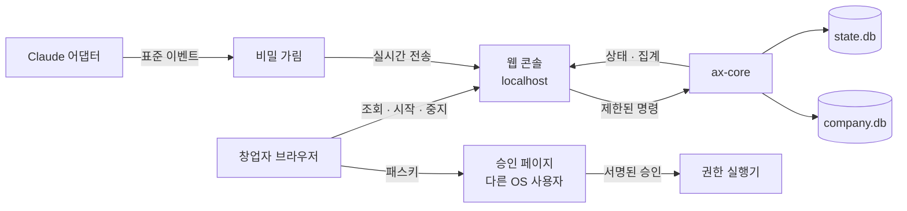

# 15. 창업자 콘솔과 대시보드

**결론: 창업자는 내 PC의 웹 콘솔에서 보고 판단한다. 승인은 별도 승인 페이지에서 한다. 터미널은 탐색과 문제 해결에 쓴다.**

창업자가 2026-11-25에 콘솔과 대시보드를 확정했다([ADR-0011](adr/0011-founder-console.md)). 성능 수치와 화면 구성은 제안이다.

## 1. 일하는 방식

| 순서 | 창업자가 하는 일 | 장소 |
|---:|---|---|
| 1 | 결정할 일, 위험, 남은 시간을 본다 | 대시보드 |
| 2 | 목표를 넣고 PM 역할이 만든 수용 기준을 확인한다 | 콘솔 |
| 3 | 작업을 시작하고 진행을 본다. 필요하면 멈춘다 | 콘솔 |
| 4 | 요구가 불분명하거나 막히면 대화한다 | 터미널 |
| 5 | 결과와 증거를 보고 수정 요청 또는 병합 확인으로 간다 | 콘솔 → 승인 페이지 |
| 6 | R2와 R3의 대상, 비용, 되돌리기를 보고 승인한다 | 승인 페이지 |
| 7 | 쓴 시간을 확정하고 다음 일을 고른다 | 콘솔 |

범위가 정해진 구현은 AX가 `claude -p`로 실행한다. 탐색과 설계는 터미널의 대화형 세션을 쓴다. 두 기록은 같은 작업에 묶는다.
비대화형 실행도 창업자가 자리에 있을 때만 시작한다. 콘솔은 무인 실행을 허용하는 근거가 아니다.

## 2. 구조

콘솔은 DB 파일을 직접 열지 않는다. `ax-core`의 제한된 명령만 부른다. 콘솔이 꺼져도 작업과 서비스는 멈추지 않는다. 모든 조회와 동작은 `ax` 명령으로도 할 수 있다.

## 3. 화면

| 화면 | 보는 것 | 할 수 있는 일 |
|---|---|---|
| 오늘 | 결정할 것, 막힌 작업, 기한, 남은 시간 | 순서 변경, 다음 주로 이동 |
| 작업 | 상태, 목표, 수용 기준, 위험 | 생성, 수정, `ready`, 우선순위 |
| 진행 | 단계, 활동, 시간, 턴, 사용량 | 중지, 다음 시도에 줄 의견 |
| 결과 | 요약, 변경, 시험·리뷰 증거 | 수정 요청, 승인 페이지 열기 |
| 승인 | 대기 목록과 만료 | 승인 페이지 열기만 |
| 서비스 | 생애주기, 버전, SLO, 비용, 사고 | 작업 생성 |
| 회사 | 12개 모듈의 기록과 검토 일정 | 기록 입력, 결정 기록 |
| 대시보드 | §6의 판단 화면 | 원인 보기, 작업·결정 생성 |

콘솔은 승인, 정책 변경, 위험 하향, 자격증명 조회를 할 수 없다.

## 4. 실시간 진행

| 방식 | 콘솔에 보이는 것 | 개입 |
|---|---|---|
| AX 실행 | 메시지, 도구 호출, 결과, 단계 | 중지, 다음 시도에 의견 |
| 대화형 터미널 | Hook이 알린 도구 사용과 단계 | 터미널에서 대화 |

- AX 실행은 어댑터가 구조화 출력을 표준 이벤트로 바꾼다. 이벤트는 `run_started`, `message`, `tool_started`, `tool_finished`, `usage`, `phase`, `run_finished`다.
- 브라우저에는 SSE로 보낸다. 연결이 끊기면 마지막 번호부터 다시 받는다. 순서가 빠지면 화면에 표시한다.
- 이벤트는 비밀을 가린 뒤 저장하고 전송한다. 암호화 원본은 14일, 검사본은 90일 둔다([03](03-memory-learning.md) §7).
- 화면은 AI의 행동과 결과를 보여 준다. 내부 사고 전체를 보여 준다고 보장하지 않는다.
- 이벤트는 진행 표시용이다. 시험과 리뷰의 증거로 쓰지 않는다.
- 비대화형에서 권한 질문은 거부로 처리된다(실측). 필요한 권한은 시작 전에 정한다.
- 중지는 `ax task stop`이다. 프로세스를 끝낸 뒤 작업을 `blocked`로 둔다.
- 브라우저 안에 터미널을 넣지 않는다. 콘솔이 뚫리면 PC의 명령 실행으로 이어지기 때문이다.

## 5. 작업 요약

| 칸 | 내용 | 만든 쪽 |
|---|---|---|
| 사실 | 변경 파일, 시험, 리뷰, 시간, 사용량. 모두 증거에 연결 | 코드 |
| AI 설명 | 변경 이유, 남은 위험, 시도한 방법 | AI, 참고 표시 |
| 내 할 일 | 확인할 것 최대 3개와 예상 시간 | 코드와 AI 초안 |

증거가 없으면 `확인 안 됨`으로 표시한다. AI 설명으로 사실 칸을 채우지 않는다. 기본 화면은 요약이고 누르면 실시간 기록을 연다.

## 6. 판단 대시보드

대시보드는 숫자 모음이 아니다. 패널마다 질문, 값, 기준, 근거, 다음 행동이 있다.

| 대시보드 | 답하는 질문 | 주요 패널 | 판단과 행동 |
|---|---|---|---|
| 오늘 | 지금 무엇을 결정해야 하나 | 결정 대기, 막힘, 기한, 남은 시간 | 순서 변경, 미루기 |
| 개발·품질 | 일이 안전하게 진행되나 | 흐름 시간, 실패 단계, 리뷰 발견, 사용 한도 | 범위 축소, 개선 작업 |
| 서비스 운영 | 고객에게 문제가 있나 | SLO, 사고, 배포, 비용, 문의 | 되돌리기 검토, 사고 작업 |
| 사업 | 계속할 만한가 | 수익·비용, 현금 기간, 가격 실험, 마케팅, 유지율 | 지속·변경·보류 결정 |
| 회사 위험 | 놓치면 안 되는 것은 무엇인가 | 의무 기한, 갱신, 계약, 위험, 백업 | 작업 생성, 전문가 확인 |
| 학습 | AX가 나아지고 있나 | 지식 이전, 강등, 예상 대비 실제 시간, 열린 피드백, 반복 문제, 효과 확인 결과([17](17-feedback-loop.md)) | 승격·폐기 검토 |

### 패널 규칙

1. 값, 비교 기준, 단위, 기간, 집계 시각, 출처를 함께 보인다.
2. 자료가 없으면 `자료 없음`이다. 0으로 보이지 않는다. 오래된 자료는 흐리게 하고 시각을 표시한다.
3. 실적, 예상, 모의 값을 글자와 모양으로 구분한다. 색만으로 구분하지 않는다.
4. 값을 누르면 계산식과 원본 기록까지 내려간다.
5. 사업 지표에는 반대 지표를 함께 둔다. 표본이 정한 최소값보다 작으면 판정하지 않는다.
6. 경고는 기준을 넘은 시각과 권장 행동을 보인다. 같은 경고는 묶는다.
7. 모듈은 명세로 패널을 추가한다. 임의 SQL과 스크립트를 넣지 못한다.

### 판단 지원

1. 창업자가 패널에서 `판단하기`를 연다.
2. 콘솔은 그때의 지표 스냅샷과 관련 기록을 고정한다.
3. AI는 선택지, 근거, 반대 근거, 모르는 것을 초안으로 쓴다. 출처 없는 수치는 버린다.
4. 창업자가 선택, 이유, 다시 볼 날을 적는다.
5. AX는 결정 기록을 만들고 필요한 작업의 초안을 만든다. 자동 실행하지 않는다.
6. 다시 볼 날에 예상과 실제를 비교한다.

## 7. 보안

- 콘솔은 `127.0.0.1`에만 연다. `ax console open`이 60초짜리 1회 주소를 만든다. 세션은 8시간이다.
- `Host`, `Origin`, 요청 위조 토큰을 매번 확인한다. 쿠키는 `HttpOnly`, `SameSite=Strict`다.
- 쿠키는 포트로 나뉘지 않는다. 그래서 승인 페이지는 쿠키 세션을 쓰지 않고 승인마다 패스키를 요구한다.
- 실행기는 승인 페이지의 정확한 출처만 받는다. 콘솔 출처의 서명은 거부한다.
- AI와 외부 글은 일반 텍스트로 보인다. 링크와 이미지를 자동으로 열지 않는다. CSP는 외부 전송과 인라인 스크립트를 막는다.
- 에이전트의 웹 도구에서 `localhost`를 막는다.
- 시작, 중지, 결정은 `actor`와 멱등 키를 가진 이벤트로 남긴다.
- 휴대폰 조회는 P2 뒤 선택이다. 그전에는 외부에 열지 않는다.

## 8. 만드는 시점

| 시점 | 범위 |
|---|---|
| P1 | 작업 목록, 실시간 진행, 결과 요약, 시작·중지, 승인 연결 |
| P2 | 오늘, 서비스, 시간 기록, 개발·품질과 서비스 운영 대시보드 |
| P3 | 회사, 사업, 회사 위험, 학습 대시보드, 판단 지원 |

콘솔을 만들기 전의 P0과 P1 앞부분은 터미널에서 일한다.

## 9. 수용 기준

- C-01: 이벤트 발생부터 화면 표시까지 p95 2초 이하이다. 재연결 뒤 중복과 빠짐이 없다.
- C-02: 콘솔을 강제 종료해도 작업의 상태와 결과가 바뀌지 않는다.
- C-03: 다른 사이트, 샌드박스, 만료된 주소의 요청이 거부된다.
- C-04: AI 출력의 HTML, 링크, 제어 문자가 실행되지 않는다. 합성 비밀이 화면과 저장 기록에 없다.
- C-05: 콘솔의 어떤 요청도 승인, 정책, 위험 하향을 만들지 못한다.
- C-06: 같은 시작·중지 요청을 두 번 보내도 한 번만 적용된다.
- C-07: 증거 없는 시험 성공 주장이 사실 칸에 들어가지 않는다.
- C-08: 빈 자료, 오래된 자료, 모의 자료를 실제 0이나 실적으로 표시하지 않는다.
- C-09: 패널의 값에서 원본 기록까지 내려갈 수 있고 검산 값이 같다.
- C-10: 결정 기록의 지표 스냅샷은 나중에 원본 지표가 바뀌어도 같다.
- C-11: 세로 1080px, 가로 1440px 화면에서 페이지가 옆으로 넘치지 않는다. 키보드로 모든 동작을 할 수 있다.
