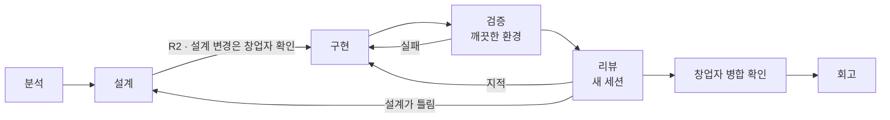

# 16. 구축 하네스

**결론: AX를 만드는 동안에는 얇은 하네스를 쓴다. 스크립트가 순서와 증거를 검사하고, AI가 생각하고 쓰며, 창업자가 결정한다.**

창업자가 2026-11-25에 채택했다([ADR-0012](adr/0012-build-harness.md)). 이 하네스는 AX의 게이트를 대신하는 보안 경계가 아니다.

## 1. 두 하네스

| | 구축 하네스 | AX |
|---|---|---|
| 하는 일 | AX를 만든다 | 서비스를 만들고 운영한다 |
| 구성 | `CLAUDE.md`, Skill, `axb` | 상태 머신, 정책, 게이트, 콘솔 |
| 강제력 | 절차, 스크립트, 창업자 확인 | 코드와 권한 분리 |
| 끝나는 때 | P1 게이트 뒤 역할과 Skill을 AX로 옮긴다 | 계속 |

## 2. 흐름

| 단계 | 산출물 | 다음 조건 |
|---|---|---|
| 분석 | `analysis.md` | 범위, 근거, 모르는 것이 있음 |
| 설계 | `design.md` | 변경, 시험, 되돌리기가 있음. R2와 설계 변경은 창업자 확인 |
| 구현 | 커밋 | 허용 경로 안의 변경만 있음 |
| 검증 | `verify.json` | 현재 내용에서 모든 명령 성공 |
| 리뷰 | `review.json` | 모든 수용 기준 확인, 주요 지적 0건. R2는 Codex 추가 |
| 병합 | 확인 기록 | 창업자 터미널에서 다시 검증하고 `main`을 앞으로만 옮김 |
| 회고 | `retro.md` | 실제 시간, 잘못된 점, 개선 후보 |

R0는 설계와 리뷰를 생략한다. R3는 이 하네스로 실행하지 않는다. 되돌리기와 리뷰는 각각 최대 3회다.
P0의 실험은 가설 → 시험 → 창업자 판정 → 회고로 줄인다. 통과 조건은 시험 전에 쓴다.

## 3. 구성

| 요소 | 최소판 | P0 뒤 보완 |
|---|---|---|
| 지침 | `CLAUDE.md` | 실제 불편 반영 |
| Skill | `ax-build`, `ax-review` | 분석·설계, 구현, 회고 |
| 에이전트 | 없음 | 구현 A10, 시험 A13, 보안 A14 |
| 스크립트 | `tools/build-harness/axb.mjs` | Codex 리뷰 실행(W0-7 완료), 창업자 편의(W0-8) |
| 기록 | `work/<ID>/` | AX 작업으로 이전 |

회고의 개선 후보는 `work/feedback.md` 대장에 옮긴다. 같은 원인이면 반복 횟수를 올린다([17](17-feedback-loop.md)).
하위 에이전트는 한 번에 하나만 쓴다. 같은 세션의 하위 에이전트는 독립 리뷰를 대신하지 못한다.
설치된 harness 플러그인은 형식과 점검표를 참고하는 데 썼다. 실행에는 필요하지 않다.

## 4. 증거

- 검증과 리뷰는 커밋 내용의 해시에 묶는다. `work/`는 해시에서 뺀다. 내용이 바뀌면 둘 다 무효다.
- 검증은 네트워크와 홈이 없는 `bwrap` 안의 새 clone에서 한다.
- 작업 기록은 해시 사슬이다. 우발적인 변경과 건너뛰기를 찾는다.
- 작업 명세는 구현을 시작한 뒤 바꾸지 못한다. 설계로 되돌려도 같다. 위험 등급은 낮추지 못한다.
- 수용 기준은 analyze·design 단계(실험은 hypothesis 단계)에서만 고치거나 뺀다(`amend --set-accept`, `--drop-accept`). 뺀 ID는 다시 쓰지 않는다.
- 설계 확인은 설계서와 작업 명세에 함께 묶는다. 확인 뒤 명세가 바뀌면 다시 확인한다. 이전 하네스의 확인(형식 표시 없음)은 설계서 해시가 같고 그 뒤 명세 변경이 없을 때만 받는다. 하네스를 바꾸는 작업은 `main`의 이전 하네스로 확인하기 때문이다.
- 리뷰 입력에는 패치, 수용 기준, 바뀐 파일, 검증 결과, 작업에 지정한 참고 파일(`--context`)이 들어간다.
- 검증 환경의 clone에는 `work/`와 `.git`이 없다. 이것이 실제 차단이다. 등록 때 `work/`를 가리키는 명령을 거부하는 것은 실수를 일찍 알리는 경고다.
- `--context` 경로는 정규화한다. 저장소에 없거나, 지시 파일이거나, 400KB 이상이면 등록과 리뷰를 거부한다. 설계 변경 작업은 등록 때 ADR 경로가 있어야 한다.
- 작업은 `axb cancel`로 취소한다. 취소한 작업은 진행하지 못한다. 대신하는 작업은 `--supersedes`로 가리킨다.

## 5. 한계

1. 같은 OS 사용자의 AI는 기록과 해시를 함께 위조할 수 있다. 그래서 병합 확인 때 창업자 터미널에서 다시 검증한다.
2. 리뷰 판정 파일은 위조를 막지 못한다. P1의 병합 게이트 전까지 창업자가 리뷰 내용을 읽는다.
3. `axb confirm`은 AI 세션과 터미널이 아닌 실행을 거부한다. 이는 실수를 막는 장치이며 가짜 터미널을 막지 못한다.
4. 검증 명령은 창업자가 작업 명세에서 확인해야 한다. 약한 명령은 약한 증거다.
5. 검증에 의존성 설치가 필요하면 아직 쓸 수 없다. W1-1 전에 잠금 파일 기반 설치를 더한다.
6. Codex 리뷰는 V-05의 `bwrap` 래퍼에서만 실행한다. 리뷰어 모델은 인증 파일을 읽을 수 있다. 하네스는 값 그대로, base64(출력 안의 base64 부분을 풀어서도 찾음), 12자 이상 조각만 찾는다(창업자가 받아들인 위험, [12](12-supervised-mode.md) §4). Claude 리뷰는 권한 규칙과 도구 제한에 기댄다. Claude의 파일 도구가 입력 밖을 읽지 못하는지는 시험하지 않았다.
7. 강화 실행에서 Skill과 지침을 읽는지는 HC-21에서 시험한다.

## 6. 수용 기준

- BH-01: 단계의 산출물이 없거나 비면 넘어가지 못한다.
- BH-02: 허용 경로 밖, 미커밋, 상징 링크 변경을 거부한다.
- BH-03: 하네스, 지침, 스키마 변경은 R2에서만 허용한다.
- BH-04: 내용이 바뀌면 검증과 리뷰가 무효가 된다.
- BH-05: 빠진 수용 기준과 주요 지적이 있으면 통과하지 못한다. R2는 다른 공급자 리뷰가 없으면 멈춘다.
- BH-06: 확인은 `main`의 하네스와 터미널에서만 하고 병합 전에 다시 검증한다.
- BH-07: 되돌리기는 3회를 넘지 못한다.
- BH-08: 기록과 명세의 변경, 위험 하향을 찾는다.
- BH-09: ADR 없는 설계 변경을 거부한다.
- BH-10: 선행 작업, ID, 위험 등급을 검사한다.
- BH-11: 실험은 가설과 창업자 판정 없이 끝나지 않는다.
- BH-12: 검증에서 홈, 호스트 환경 변수, 네트워크가 보이지 않고 git Hook이 실행되지 않는다.
- BH-13: 리뷰 입력에 검증 결과와 참고 파일이 있다.
- BH-14: Codex 리뷰는 래퍼 안에서 실행되고, 인증 값이 출력에 있으면 판정을 저장하지 않는다.
- BH-15: 검증 명령의 `work/`와 ADR 경로 없는 설계 변경을 거부한다.
- BH-16: 기준 수정은 설계 단계까지만 되고, 명세가 바뀌면 설계 확인이 무효다.
- BH-17: 취소한 작업은 진행할 수 없고, 대체 관계는 취소된 작업만 가리킨다.
