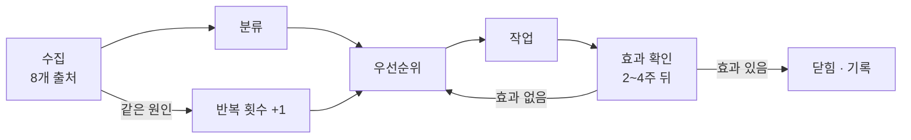

# 17. 피드백 루프

**결론: 모든 피드백을 하나의 대장에 모은다. 고친 뒤에는 효과를 다시 재고, 같은 문제가 다시 나오면 순위를 올린다.**

창업자가 2026-11-26에 채택했다([ADR-0013](adr/0013-feedback-loop.md)). 우선순위 공식과 기간은 제안 값이다.

## 1. 기존 루프

루프는 이미 여러 곳에 있다. 이 문서는 그 결과가 모이고 닫히는 길을 정한다.

| 주기 | 루프 | 위치 |
|---|---|---|
| 작업 | 검증·리뷰 실패를 구현으로 되돌림 | [02](02-orchestration.md) §1, [16](16-build-harness.md) §2 |
| 일 | 장애·문의·되돌리기를 개선 작업으로 만듦 | [13](13-service-lifecycle.md) §2 |
| 주 | 작업 증거를 학습 후보로 만듦 | [03](03-memory-learning.md) §4 |
| 주 | 예상 시간과 실제 시간을 비교함 | [14](14-business-modules.md) §7 |
| 월 | 리뷰어 발견율과 AI 품질을 잼 | [06](06-quality-security.md) §3 |
| 월 | 결정의 예상과 실제를 비교함 | [15](15-founder-console.md) §6 |
| 단계 | 일정과 지표 목표를 다시 정함 | [09](09-roadmap.md) §1, [08](08-operations.md) §3 |

## 2. 흐름

같은 원인이면 새 항목을 만들지 않는다. 기존 항목의 반복 횟수를 올리고 참조를 더한다.

## 3. 출처

| 출처 | 기록하는 때 |
|---|---|
| 작업 회고 | `retro.md`의 개선 후보 |
| 리뷰 지적 | 고친 지적과 반박한 지적 모두 |
| 검증 실패 | 같은 원인으로 두 번 이상 실패할 때 |
| 사고 | SEV1~3 사후 기록 |
| 고객 문의 | 같은 문의가 반복되거나 버그일 때 |
| 창업자 수정·거절 | 설계 확인 거절, 병합 거절, AI 초안 수정, 범위 축소 |
| 결정 재검토 | 다시 볼 날에 예상과 실제가 다를 때 |
| 지표 경고 | 기준을 넘은 경고가 해결되지 않을 때 |

## 4. 대장

| 필드 | 내용 |
|---|---|
| ID | `FB-<번호>` |
| 출처와 참조 | 출처 종류, 작업·사고·결정 ID |
| 분류 | 제품, 플랫폼, 하네스, 지식, 운영 |
| 영향 | 1 낮음, 2 중간, 3 높음 |
| 반복 횟수 | 같은 원인이 나온 수 |
| 상태 | 열림, 작업 중, 효과 확인 중, 닫힘, 버림 |
| 성공 신호 | 무엇이 줄거나 늘면 성공인지 |
| 확인 날짜 | 효과를 다시 잴 날 |
| 결과 | 효과, 근거, 닫은 이유 |

버릴 때는 이유를 남긴다. 버린 항목도 같은 원인이 다시 나오면 다시 연다.
고객의 개인정보와 비밀은 대장에 넣지 않는다. 원본은 참조 ID로만 가리킨다.

## 5. 우선순위

1. 사고와 보안은 대장 순위와 관계없이 바로 처리한다.
2. 나머지는 `영향 × 반복 횟수`로 정렬한다. 값이 같으면 오래된 항목이 먼저다.
3. 9 이상이면 다음 주의 계획에 넣는다. 나머지는 주간 검토에서 고른다.
4. 처리 시간은 [14](14-business-modules.md) §7의 시간 상한을 따른다. 대장이 상한을 늘리지 않는다.

공식과 기준값은 제안이다. 4주 뒤 실제 처리 결과로 다시 정한다.

## 6. 효과 확인

- 작업을 만들 때 성공 신호와 확인 날짜를 적는다. 날짜는 2~4주 뒤다.
- 확인 날짜에 같은 원인이 다시 나왔는지, 성공 신호가 바뀌었는지 본다.
- 효과가 없으면 다시 연다. 세 번 다시 열리면 창업자가 방향을 검토한다.
- 효과를 잴 수 없으면 그 사실을 결과에 적고 닫는다. 추측으로 성공이라 쓰지 않는다.

## 7. 창업자 수정과 거절

창업자의 수정과 거절은 AI가 혼자 알기 어려운 창업자의 기준이다.

- 무엇을, 왜 바꿨는지 한두 문장으로 남긴다. 창업자가 이유를 적지 않으면 AI가 초안을 쓰고 창업자가 고친다.
- 같은 유형이 세 번 쌓이면 지식 후보(`candidate`)를 만든다.
- 후보는 [03](03-memory-learning.md) §5의 승격 조건을 그대로 따른다. 자동으로 실행 규칙이 되지 않는다.
- 기록은 창업자를 평가하는 데 쓰지 않는다. AI의 다음 초안을 낫게 하는 데만 쓴다.

## 8. 주기

| 주기 | 할 일 | 시간 |
|---|---|---:|
| 주간 | 새 항목 분류, 순위 확인, 효과 확인 날짜가 된 항목 판정 | 15분 |
| 월간 | 닫힘 비율, 재발, 버린 항목 검토 | 주간 검토 안에서 |

P2부터 주간 15분은 [08](08-operations.md) §6의 플랫폼 관리 시간에 들어 있다. 관리 시간을 따로 빼지 않는 P0·P1에서는 개발 시간에서 뺀다([09](09-roadmap.md) §1).

## 9. 만드는 시점

| 시점 | 범위 |
|---|---|
| P0 (W0-7) | 구축 하네스의 회고를 `work/feedback.md`에 모음 |
| P1 (W1-13) | `state.db`의 대장 테이블, 창업자 수정·거절 기록. 출처는 회고, 리뷰 지적, 검증 실패, 창업자 수정·거절 |
| P3 (W3-3) | 효과 확인, 반복 감지, 학습 대시보드 연결. 사고, 고객 문의, 결정 재검토, 지표 경고 출처 연결 |

## 10. 수용 기준

- FL-01: 출처가 생긴 단계부터 그 출처의 항목이 같은 대장에 같은 형식으로 들어간다. P1에서는 회고, 리뷰 지적, 검증 실패, 창업자 수정·거절을 시험하고, 나머지 4개는 P3(W3-3)에서 시험한다.
- FL-02: 같은 원인의 항목은 새로 생기지 않고 반복 횟수가 오른다.
- FL-03: 성공 신호와 확인 날짜가 없는 항목은 작업 중으로 바뀌지 않는다.
- FL-04: 확인 날짜가 지난 항목은 주간 검토 목록에 나온다.
- FL-05: 창업자 수정 세 번은 후보만 만들고 실행 규칙을 바꾸지 않는다.
- FL-06: 대장에 고객 개인정보와 비밀이 없다.
- FL-07: 학습 대시보드에서 열린 항목, 반복 문제, 효과 확인 결과를 원본 기록까지 따라갈 수 있다.
