# Flywheel 설계 v1 설명서

**결론: AX는 서비스를 계속 만들고 운영하기 위한 기반이다. 에이전트가 일하고, 코드가 검사하고, 창업자가 판단한다.**

이 문서는 설계 v1을 확정하기 전에 읽는 안내서다. 결정의 정본은 아래 원본 문서다. 이 설명서와 원본이 다르면 원본을 따른다.

## 1. 검토하는 방법

이 설명서를 먼저 읽는다. 그다음 원본을 순서대로 읽는다. 마지막에 §14의 확인표에 답한다.
읽는 시간은 어림값이다.

### 1단계: 반드시 읽을 원본 (약 105분)

| 순서 | 원본 | 확인할 질문 | 시간 |
|---:|---|---|---:|
| 1 | [README](README.md) | 내 결정이 맞게 적혔는가 | 5분 |
| 2 | [13 서비스 생애주기](13-service-lifecycle.md) | 내가 원하는 플랫폼의 목적과 같은가 | 15분 |
| 3 | [14 기업 기능 모듈](14-business-modules.md) | 회사에 필요한 기능과 시간 규칙이 맞는가 | 13분 |
| 4 | [15 콘솔·대시보드](15-founder-console.md) | 내가 이렇게 보고 판단하고 싶은가 | 12분 |
| 5 | [01 아키텍처](01-architecture.md) | 구성 요소와 권한의 경계가 이해되는가 | 15분 |
| 6 | [12 감독 모드](12-supervised-mode.md) | 이 방식으로 매일 일할 수 있는가 | 8분 |
| 7 | [06 품질·보안](06-quality-security.md) | 요구하는 검사가 충분한가, 과하지 않은가 | 12분 |
| 8 | [ADR-0009 병합 게이트](adr/0009-private-free-merge-gate.md) | Free 요금제의 남는 약점을 받아들이는가 | 5분 |
| 9 | [04 Hook·승인](04-hooks-policy-hitl.md) | 내가 승인할 일과 만료 시간이 알맞은가. §1과 §5를 읽는다 | 10분 |
| 10 | [09 로드맵](09-roadmap.md) | 순서와 시간이 현실적인가 | 10분 |

### 2단계: 관심에 따라 읽을 원본 (약 85분)

| 순서 | 원본 | 읽을 때 |
|---:|---|---|
| 11 | [02 오케스트레이션](02-orchestration.md) | 작업의 상태와 복구가 궁금할 때 |
| 12 | [03 메모리](03-memory-learning.md) | AI가 무엇을 배우는지 궁금할 때 |
| 13 | [05 역할](05-agents-skills-mcp.md) | 에이전트 16종의 권한이 궁금할 때 |
| 14 | [08 운영](08-operations.md) | 백업, 지표, 주간 일이 궁금할 때 |
| 15 | [07 유형별 요구](07-service-blueprints.md) | Type A~D의 요구가 궁금할 때 |
| 16 | [ADR-0008 플랫폼 우선](adr/0008-platform-first.md) | 로드맵에 서비스 출시가 없는 이유가 궁금할 때 |
| 17 | [ADR-0007 구독 에이전트](adr/0007-subscription-agents.md) | API를 쓰지 않는 이유가 궁금할 때 |
| 18 | [ADR-0010 기업 기능](adr/0010-business-modules.md) | 매출 관리가 포함된 이유가 궁금할 때 |
| 19 | [ADR-0011 콘솔](adr/0011-founder-console.md) | 콘솔과 승인 페이지를 나눈 이유가 궁금할 때 |
| 20 | [ADR-0012 구축 하네스](adr/0012-build-harness.md) | 얇은 하네스를 고른 이유가 궁금할 때 |
| 21 | [17 피드백 루프](17-feedback-loop.md) | 피드백이 어떻게 모이고 닫히는지 궁금할 때 |
| 22 | [ADR-0013 피드백 루프](adr/0013-feedback-loop.md) | 피드백 대장을 둔 이유가 궁금할 때 |
| 23 | [00 초안 리뷰](00-review.md) | 초안에서 바뀐 이유가 궁금할 때 |

### 3단계: 만들 때 볼 원본

| 순서 | 원본 | 쓰는 때 |
|---:|---|---|
| 24 | [16 구축 하네스](16-build-harness.md) | AX를 만드는 절차를 볼 때 |
| 25 | [10 P0 시험 명세](10-p0-test-spec.md) | P0을 실행할 때 |
| 26 | [11 Phase 1 구현](11-phase1-implementation.md) | P1을 개발할 때 |
| 27 | [리뷰 기록](REVIEW-LOG.md) | 고친 결함을 추적할 때 |

`schemas/`와 `evidence/`는 기계가 쓰는 계약과 실측 기록이다. 확정 검토에서는 읽지 않아도 된다.
`adr/0001`~`0006`은 이전 결정 기록이다. `adr/0005`는 ADR-0008로 대체됐다.

## 2. AX가 하는 일

AX는 특정 서비스를 만드는 도구가 아니다. 여러 서비스를 같은 방식으로 만들고 운영하게 한다.
Type A~D는 지금 만들 대상이 아니다. 앞으로 AX가 받아들여야 할 요구 조건이다.

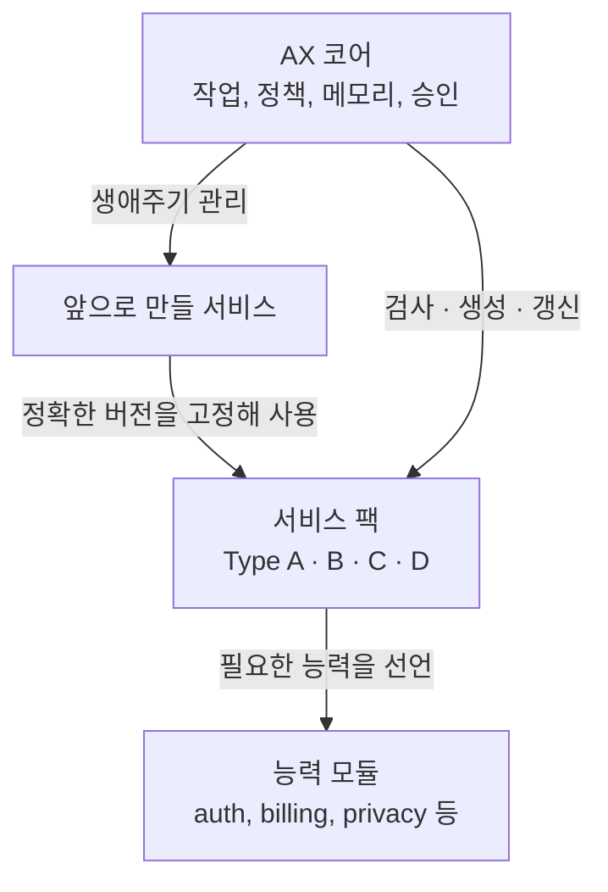

코어는 Type A~D의 이름을 모른다. 그래서 새 유형을 더해도 코어를 고치지 않는다.
서비스는 AX가 꺼져도 동작한다.

원본: [13](13-service-lifecycle.md) §1, §4

## 3. 누가 무엇을 하는가

에이전트를 신뢰하지 않는다. 에이전트의 결과는 검사할 입력이다.

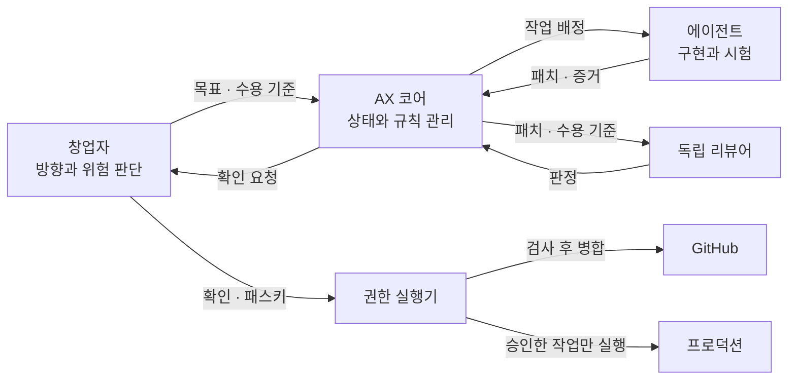

| 주체 | 하는 일 | 하지 못하는 일 |
|---|---|---|
| 창업자 | 목표, 위험, 되돌리기 어려운 일을 결정한다 | - |
| 에이전트 | 코드, 시험, 문서를 만든다 | 병합, 배포, 위험도 낮추기 |
| AX 코어 | 상태를 바꾸고 규칙을 검사한다 | GitHub에 쓰기 |
| 리뷰어 | 실패하는 입력을 찾는다 | 코드 수정 |
| 권한 실행기 | 확인된 병합과 배포를 실행한다 | 임의 명령 실행 |

원본: [01](01-architecture.md) §3, §4

## 4. 서비스의 일생

모든 서비스는 같은 단계를 지난다. 각 단계에는 필수 산출물과 다음 단계의 조건이 있다.

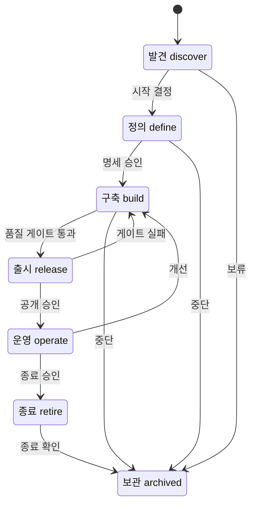

수요와 수익은 서비스를 시작할 때 `discover`에서 판단한다. 플랫폼의 설계와 일정에는 쓰지 않는다.
실제 서비스가 없어도 검증할 수 있게 공개하지 않는 기준 서비스 2개를 만든다.

| 기준 서비스 | 확인하는 것 |
|---|---|
| `ref-stateless` | 생성, 미리보기 배포, 되돌리기 |
| `ref-stateful` | 로그인, 테넌트, DB 변경, 복원 |

기준 서비스는 Type C와 D의 실행을 보장하지 않는다.

원본: [13](13-service-lifecycle.md) §3, §8

## 5. 기능 하나를 만드는 과정

코드가 다음 단계로 보낸다. 모델의 말로는 다음 단계에 가지 않는다.

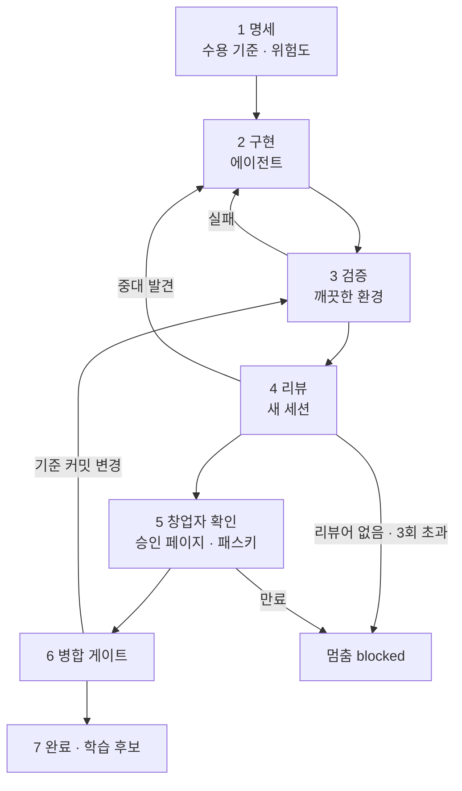

구현 시도와 리뷰는 각각 최대 3회다. 멈춘 작업은 창업자가 다시 시작한다.
검증을 리뷰보다 먼저 한다. 실패할 코드의 리뷰에 사용량을 쓰지 않기 위해서다.

원본: [02](02-orchestration.md) §1, §2

## 6. 위험에 따른 검사

위험이 클수록 더 많이 검사한다. 에이전트는 위험도를 올릴 수만 있다.

| 등급 | 예 | 리뷰 | 창업자 |
|---|---|---|---|
| R0 | 문서, 로컬 분석 | 없음. 자동 검사만 | 패스키로 병합 확인 |
| R1 | 일반 기능 | Claude 새 세션 | 패스키로 병합 확인 |
| R2 | 인증, 결제 코드, DB, 정책 | Claude 새 세션 + Codex | 더 자세한 승인 + 패스키 |
| R3 | 배포, 외부 발송, 지출 | R2와 같음 | 1회용 패스키 승인 |

R0와 R1의 병합 확인은 P1 동안 필수다. 자동 병합은 P2 뒤에 따로 결정한다.
Codex를 쓸 수 없으면 R2는 멈춘다. Claude로 대신하지 않는다.

원본: [01](01-architecture.md) §9, [06](06-quality-security.md) §2, §3

## 7. 지금 일하는 방식: 감독 모드

창업자가 지켜보는 동안에만 에이전트를 실행한다. 동시 작업은 1개다.
구독 로그인은 PC에 두고, 에이전트의 명령만 샌드박스에서 실행한다.

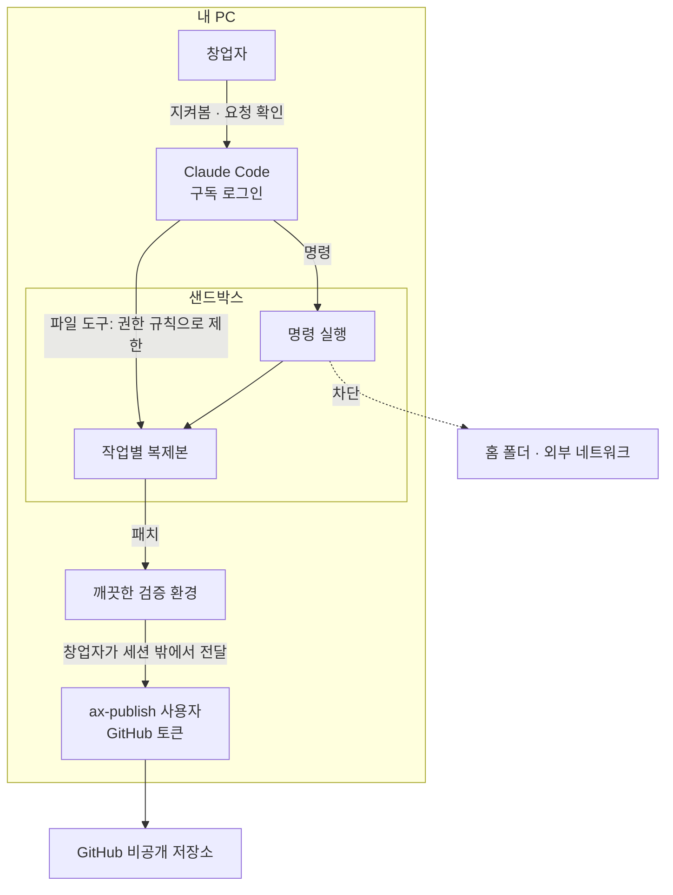

파일 도구는 샌드박스 밖에서 동작한다. 이것이 감독 모드의 남는 위험이다.
`socat`이 없으면 강화 설정의 세션은 시작되지 않는다.

원본: [12](12-supervised-mode.md), [ADR-0007](adr/0007-subscription-agents.md)

## 8. 잘못된 일을 막는 구조

한 장치가 뚫려도 다음 장치가 막거나 찾는다. Hook은 빠른 알림이며 최종 경계가 아니다.

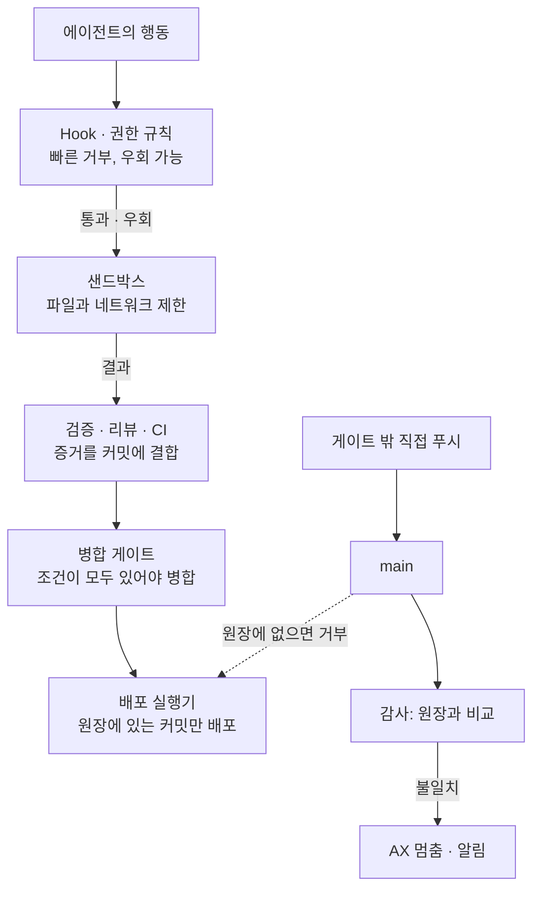

비공개 저장소와 Free 요금제에는 GitHub의 서버 보호 규칙이 없다.
토큰이나 계정을 탈취당하면 `main`에 직접 푸시할 수 있다. 감사는 이를 막지 않고 찾는다.
무인 실행이나 자동 병합을 열기 전에는 Pro로 올린다.

원본: [04](04-hooks-policy-hitl.md) §1, [ADR-0009](adr/0009-private-free-merge-gate.md)

## 9. 승인하는 방법

승인 페이지는 내 PC에서만 연다. 승인은 보여 준 내용에만 한 번 유효하다.

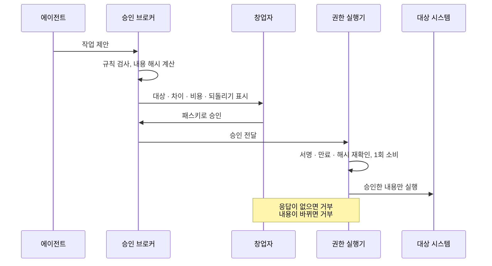

| 작업 | 승인 만료 |
|---|---:|
| DB 변경 | 1시간 |
| 프로덕션 배포 | 2시간 |
| 외부 발송 | 4시간 |
| R2 병합 | 24시간 |

휴대폰 승인은 P2 뒤의 선택이다. 실제 기기에서 먼저 시험한다.

원본: [04](04-hooks-policy-hitl.md) §5

## 10. 배우는 방법

메모리는 명령이 아니라 증거가 붙은 데이터다. 자동화는 후보만 만든다.

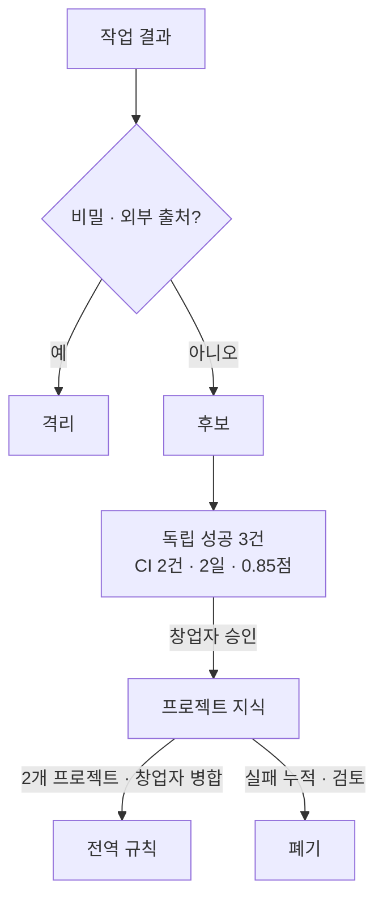

서비스가 하나뿐이면 전역 규칙으로 승격하지 않는다.
야간 정리(Dreaming)는 P3에서 만든다. 검사를 통과한 세션 100건 전에는 시험 데이터로만 실행한다.

원본: [03](03-memory-learning.md) §4~§6

## 11. 회사가 함께 쓰는 기능

서비스마다 다시 만들지 않는 기업 기능 12개를 AX에 둔다. 각 기능은 회사 기준과 서비스별 결과를 함께 관리한다.

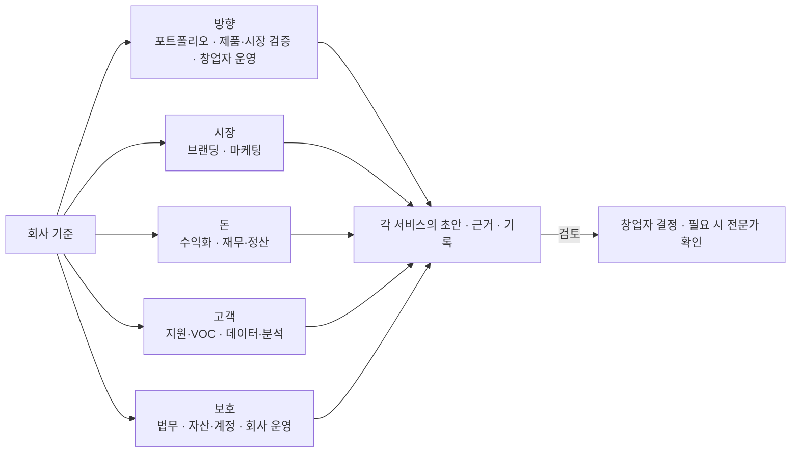

창업자 시간 상한은 할 일의 양과 순서를 정한다. 위험 등급과 검토를 낮추지 않는다.
기업 기능의 확인 시간은 출시 전 주 1시간, 출시 후 주 3시간으로 시작한다. 4주를 재고 다시 정한다.

원본: [14](14-business-modules.md)

## 12. 내가 보는 화면: 콘솔과 대시보드

평소에는 웹 콘솔에서 보고 판단한다. 승인만 별도 페이지에서 한다. 탐색은 터미널에서 한다.

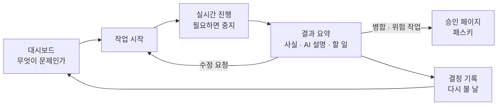

| 대시보드 | 판단할 질문 |
|---|---|
| 오늘 | 지금 무엇을 결정해야 하나 |
| 개발·품질 | 일이 안전하게 진행되나 |
| 서비스 운영 | 고객에게 문제가 있나 |
| 사업 | 이 서비스를 계속할 만한가 |
| 회사 위험 | 놓치면 안 되는 것은 무엇인가 |
| 학습 | AX가 나아지고 있나 |

실시간 화면은 AI의 행동과 결과를 보여 준다. 대화형 터미널의 글 전체나 내부 사고를 모두 보여 주지는 않는다.
대시보드는 자료가 없거나 오래되면 그 사실을 표시한다. AI는 선택지를 쓰고 창업자가 결정한다.

원본: [15](15-founder-console.md)

## 13. 일정과 검증 상태

주 16시간에서 관리와 기업 기능 시간을 뺐다. 개발은 P0·P1에 주 15시간, P2·P3에 주 12시간이다. 첫 추정이며 -20%에서 +60%까지 다를 수 있다.

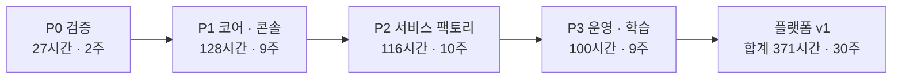

2026-11-30에 시작하면 2027-06-27에 끝난다. 휴일과 개별 서비스의 개발 시간은 포함하지 않았다.

| 상태 | 내용 |
|---|---|
| 확인함 | DB 상태 규칙, 동시성, 스키마, 기업 기능 예제, Hook 주요 동작, 강화 샌드박스 |
| 확인하지 못함 | Codex 격리(V-05), PreCompact, 대화형 Hook |
| 확인하지 못함 | 콘솔의 실시간 전송, 기업 기능의 실제 업무 |
| 확인하지 못함 | GitHub 토큰과 게이트, 실제 기기의 패스키 |
| 근거가 부족함 | 시간, 점수, 만료, 상한. 대부분 제안 값이다 |
| 하지 않음 | 다른 공급자 모델의 리뷰, 사람의 리뷰, 법률 검토 |

설계 v1을 확정해도 미확인 항목이 사실이 되지는 않는다. P0 결과가 다르면 설계를 고친다.

원본: [09](09-roadmap.md), [10](10-p0-test-spec.md), [REVIEW-LOG](REVIEW-LOG.md)

## 14. 설계 v1 확인표

**확정:** 창업자가 2026-11-25에 1~14번 모두에 동의했다. 이후 변경은 새 ADR과 리뷰 기록으로 남긴다. 확정 뒤 구축 하네스 6시간과 피드백 루프 8시간, 하네스 보완 2차 2시간이 더해져 합계는 371시간, 30주다.

| 번호 | 확인할 결정 | 원본 |
|---:|---|---|
| 1 | AX의 목적은 여러 서비스를 위한 플랫폼이다. 서비스 출시를 로드맵에 넣지 않는다 | [13](13-service-lifecycle.md) §1 |
| 2 | 여유를 뺀 시간은 주 16시간이다. 개발에는 주 15시간, P2부터 12시간을 쓴다 | [09](09-roadmap.md) §1 |
| 3 | 무인 실행 없이 감독 모드와 동시 작업 1개로 시작한다 | [12](12-supervised-mode.md) |
| 4 | 파일 도구가 샌드박스 밖에서 도는 위험을 감독으로 관리한다 | [12](12-supervised-mode.md) §5 |
| 5 | P1의 모든 병합을 창업자가 패스키로 확인한다 | [06](06-quality-security.md) §2 |
| 6 | Codex가 없으면 R2 작업을 멈춘다 | [06](06-quality-security.md) §3 |
| 7 | Free 요금제의 직접 푸시 위험을 감사와 배포 차단으로 관리한다 | [ADR-0009](adr/0009-private-free-merge-gate.md) |
| 8 | 승인 만료 시간과 하루 10건 상한이 알맞다 | [04](04-hooks-policy-hitl.md) §5 |
| 9 | 지식은 창업자 승인 뒤에만 실행 규칙이 된다 | [03](03-memory-learning.md) §5 |
| 10 | P0, P1, P2, P3의 순서와 통과 조건에 동의한다 | [09](09-roadmap.md) |
| 11 | 기업 기능 12개와 시간 상한을 쓴다. **구성과 상한은 확정됨** | [14](14-business-modules.md) |
| 12 | 웹 콘솔, 실시간 진행, 요약, 대시보드를 쓴다. **방향은 확정됨** | [15](15-founder-console.md) |
| 13 | 콘솔에서는 승인하지 않고 승인 페이지로 나눈다 | [ADR-0011](adr/0011-founder-console.md) |
| 14 | 늘어난 범위와 355시간, 29주의 첫 추정을 받아들인다 | [09](09-roadmap.md) §1 |
