# Flywheel Platform Build Plan (Draft)

| Item | Value |
|---|---|
| Status | Draft v0.2 (review needed) |
| Created | 2026-11-27 |
| Revised | 2026-11-28 (module catalog review applied) |
| Input | [request-draft.md](request-draft.md) |
| Reference | [draft/](draft/README.md) (previous detailed design v1) |
| Writing rules | STE (§15). Korean original: [plan-draft.md](plan-draft.md) |

**Conclusion: Flywheel is a platform that runs a one-person company as an organization of AI agents. It has 24 modules in 3 layers: Company, Project, and Memory. Each module owns a defined set of artifacts, so module boundaries do not overlap. All modules use the same contract to install, enable, disable, and remove. Two Orchestrators divide and run the work. Every workflow has a Feedback Loop and HITL gates. The build has 5 phases. The first phase is the Platform harness and the module contract.**

---

## 1. Background and Problem

A solo developer wants to build and run many services. But the developer did not finish the services because of these problems.

| ID | Problem | Result |
|---|---|---|
| PB-01 | Each project builds a new harness. | The same work repeats. |
| PB-02 | Each project handles branding, marketing, design, and cost separately. | Work scatters and items get lost. |
| PB-03 | Lessons from one project do not move to the next project. | The same mistakes repeat. |
| PB-04 | Status and risk are not visible in one place. | A stalled project goes unnoticed. |

Flywheel solves these problems with the structure of a "one-person company". Company-wide functions become Company modules. Project functions become Project modules. Knowledge accumulates in Memory modules. Each finished project makes the company more capable. This cycle is the "Flywheel".

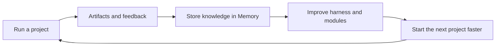

## 2. Goals, Non-goals, Success Metrics

### 2.1 Goals

| ID | Goal |
|---|---|
| G-01 | Provide Company modules that run a one-person company. |
| G-02 | Provide Project modules that plan, design, build, and operate projects. |
| G-03 | Provide Memory modules that store and improve company and project knowledge. |
| G-04 | Provide growing harnesses that improve the Platform and each Project. |
| G-05 | Let the founder see and decide on all projects from one screen. |

### 2.2 Non-goals (out of v1 scope)

- Do not build multi-user collaboration.
- Do not train custom AI models.
- Do not build a general workflow engine (for example, an Airflow replacement).
- Do not let agents change production without human approval.

### 2.3 Success Metrics (proposed)

These values are **proposals**. Measure a baseline in Phase 1, then confirm the targets.

| ID | Metric | Formula | Target |
|---|---|---|---|
| KPI-01 | New project setup time | Time from project creation to first PRD approval | 1 day or less |
| KPI-02 | Shared module reuse rate | Reused modules ÷ modules used by the project | 70% or more |
| KPI-03 | Founder management time | Weekly time for approvals, reviews, and decisions | 5 hours/week or less |
| KPI-04 | Feedback closure rate | Closed feedback ÷ received feedback (30 days) | 80% or more |
| KPI-05 | Project completion rate | Launched projects ÷ started projects | Increase over baseline |
| KPI-06 | Rule-violating merges | PRs merged with LOC or architecture violations | 0 |

Also watch counter-metrics. Do not use the "number" of promoted knowledge items as a target. That target increases low-quality knowledge.

## 3. Requirements

### 3.1 Functional Requirements

| ID | Requirement | Source | Section |
|---|---|---|---|
| FR-01 | Build an AI Native platform and management tool that runs many projects. | Req. 1 | §5, §6 |
| FR-02 | Build a growing harness that builds and improves the Platform. | Req. 2 | §11 |
| FR-03 | Build a growing harness that builds and improves each project. | Req. 3 | §11 |
| FR-04 | Build a Memory service that stores and improves company and project knowledge. | Req. 4 | §10 |
| FR-05 | Modules can be added, removed, enabled, and disabled. | Req. 5 | §7 |
| FR-06 | Every workflow has a Feedback Loop and HITL. | Req. 6 | §9 |
| FR-07 | Provide a Platform Orchestrator and a Project Orchestrator. | Req. 7 | §8 |
| FR-08 | Write all documents in STE-KO and include diagrams. | Req. 8 | §15 |
| FR-09 | The design SSOT is HTML. The design system is atomic and supports a palette per project. | Req. 9 | §12 |
| FR-10 | Use Clean Architecture and DDD by default. DDD is optional per service. | Req. 10 | §13 |
| FR-11 | Functions are 25 LOC or less. 26–50 LOC needs a stated reason. Over 50 LOC must be split. | Req. 10 | §13.3 |

### 3.2 Non-functional Requirements (proposed)

| ID | Requirement | Measurement |
|---|---|---|
| NFR-01 | Agents do not hold production credentials. | Secret lookups fail in the sandbox. |
| NFR-02 | A process crash does not lose completed task state. | 0 losses in forced-kill tests |
| NFR-03 | Disabling a module stops all its agents, Skills, and Hooks. | Call test after disable |
| NFR-04 | Monthly AI cost does not exceed the budget cap. | Budget ledger |
| NFR-05 | Memory search is p95 200 ms or less at 10,000 records. | Benchmark |
| NFR-06 | Every high-risk action has a founder approval record. | Audit log |

## 4. Concept Model

Flywheel sees the company as 3 layers. Each layer is a set of modules.

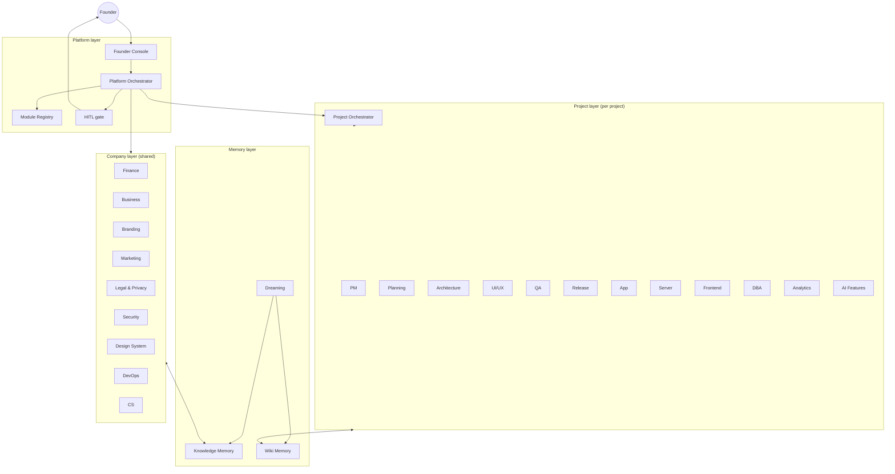

### 4.1 Key Terms

| Term | Meaning |
|---|---|
| Module | One bundle of business function. It has agent roles, Skills, workflows, templates, and a Memory scope. |
| Company module | A module with one instance for the whole company. All projects share it. |
| Project module | A module instance created for each project. |
| Orchestrator | An executor that splits work, sets the order, and collects results. |
| Harness | The set of rules, tools, Hooks, and evaluations that runs agents. |
| HITL gate | A point where a human must confirm before the next step. |
| Feedback Loop | A cycle that evaluates results and uses them to fix the next run. |
| SSOT | One source of truth for each piece of information. |

### 4.2 Module Structure

Every module has the same 6 elements.

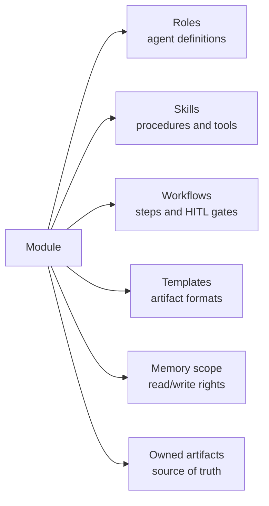

Each artifact has exactly one owner module. Other modules read the artifact or request a change. They do not change it directly (§6.6).

## 5. System Architecture

### 5.1 Components

| Component | Responsibility |
|---|---|
| `fw` CLI | Command-line tool for the founder and the Orchestrators. |
| Founder Console | Web dashboard. Shows progress, pending approvals, cost, and risk. |
| Control Plane (`fw-core`) | Decides task state, permissions, approvals, and budget. Runs outside agents. |
| Module Registry | Manages the module list, versions, and state (enabled/disabled). |
| Platform Orchestrator | Runs company-level work and creates projects. |
| Project Orchestrator | Runs the workflow of one project. |
| Harness Adapter | Calls agent tools such as Claude Code and Codex in the same way. |
| Memory Service | Stores, searches, and promotes Knowledge and Wiki records. |
| HITL Gateway | Creates approval requests, verifies founder responses, and records them. |
| Sandbox | Isolated environment where agents run. It has no secrets. |
| Core Services | Agent config audit, eval management, budget and model router, integration management. Cannot be disabled (§6.5). |

### 5.2 Trust Boundary

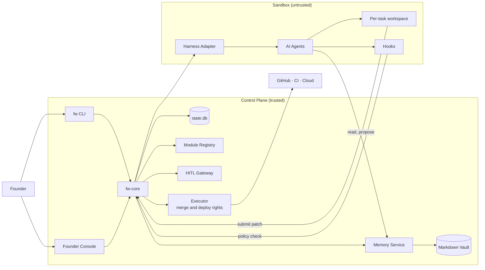

Rules:

1. Agents are untrusted workers.
2. Agents only propose. The Executor merges and deploys.
3. The Executor runs only after it checks the HITL approval record.
4. Hooks give fast feedback. They are not the final security boundary. The final boundary is the sandbox, the absence of credentials, and the merge gate. (Reuses previous design [ADR-0002](draft/adr/0002-hooks-not-boundary.md).)

### 5.3 Technology Stack (proposed)

| Area | Proposal | Reason |
|---|---|---|
| Control Plane, CLI | TypeScript (Node.js) | Same language as the Console. Good MCP SDK support. |
| State store | SQLite (WAL) | Enough for one person on a local machine. Easy backup. |
| Memory source of truth | SQLite + FTS; Markdown Vault as derived copy | Supports search and human editing. |
| Vector search | `sqlite-vec` (Phase 3) | No separate server. |
| Console | Next.js | Same as the default Frontend module stack. |
| Agent harness | Claude Code (primary), Codex (cross review) | Usable by subscription. Supports Hooks, Skills, and MCP. |
| Tool integration | MCP servers | Expose module tools in a standard way. |
| Code hosting | GitHub monorepo + one repo per project | Use branch protection and CI as the merge gate. |

## 6. Module Catalog

Priority is P1 (first), P2 (next), P3 (later). Priorities are **proposals**.
v0.2 adds 4 modules. Added modules show **Added** in the "Origin" column. The other modules come from [request-draft.md](request-draft.md).

| Layer | Request | Added | Total |
|---|---:|---:|---:|
| Company | 8 | 1 | 9 |
| Project | 9 | 3 | 12 |
| Memory | 3 | 0 | 3 |
| Total | 20 | 4 | 24 |

### 6.1 Company Modules

| Module | Origin | Responsibility | Main artifacts | Main HITL gates | Priority |
|---|---|---|---|---|---|
| Finance | Request | Records and analyzes cost and revenue. Tracks AI, cloud, and subscription cost. Manages tax deadlines. | Monthly P&L, budget ledger, cost alerts, subscription list, tax calendar | Budget cap change, paid service sign-up or cancel | P1 |
| Business | Request | Analyzes business viability. Writes business plans. Sets revenue models and prices. Manages the service portfolio. | Market analysis, business plan, price sheet, P&L scenarios, Go/No-Go material | Project start, hold, or stop; price approval | P2 |
| Branding | Request | Designs and develops the company and service brands. | Brand guide, name candidates, logo drafts, tone and manner | Brand approval | P2 |
| Marketing | Request | Promotes services. Plans channels and campaigns and analyzes results. Writes store and landing copy. | Launch plan, content drafts, store copy, campaign reports | External posting, ad spend | P3 |
| Legal & Privacy | **Added** | Writes terms, privacy policy, and store privacy labels. Checks open-source licenses and AI-use notices. Records data flows. | Terms and policy drafts, data flow diagram, license checklist, issue list | Legal document publishing. External expert check for high-risk issues | P2 (before first launch) |
| Security | Request | Finds vulnerabilities. Sets and checks security standards. Manages security assets such as accounts, API keys, and domains. | Threat model, vulnerability report, security checklist, asset and account register | Risk acceptance, exception approval, key rotation | P1 |
| Design System | Request | Designs, builds, and develops the shared design system. | HTML component catalog, design tokens | Token and component change merge | P1 |
| DevOps | Request | Designs and builds deployment and operations infrastructure. Creates monitoring, alerting, and incident procedures. | IaC, CI/CD pipeline templates, observability dashboard, runbooks, postmortems | Infrastructure change | P2 |
| CS | Request | Answers customer inquiries. Manages help content. | Reply drafts, FAQ and help docs, inquiry classification report | Replies sent to customers | P3 (lowest) |

### 6.2 Project Modules

| Module | Origin | Responsibility | Main artifacts | Main HITL gates | Priority |
|---|---|---|---|---|---|
| Project Manager | Request | Analyzes progress and risk. Keeps the project healthy. Records founder decisions. | Milestones, task board, weekly status, risk register, decision log | Schedule or scope change | P1 |
| Planning | Request | Analyzes and plans the service. | PRD | PRD approval | P1 |
| Architecture | Request | Designs the structure that implements the plan. | ADR, Technical Spec | ADR and Spec approval | P1 |
| UI/UX Design | Request | Designs usability and screens. Checks accessibility. | User flows, wireframes, HTML screen drafts, accessibility checklist | Screen draft approval | P2 |
| App | Request | Develops apps. Supports React Native, Android (Kotlin), and iOS (Swift). | App code, unit tests, builds | Merge | P2 |
| Server | Request | Develops servers. Supports Kotlin, Go, Python, and Node. | API code, unit tests, API spec | Merge | P1 |
| Frontend | Request | Develops web UI. Supports Next.js, React, and HTML+CSS. Sets up the i18n resource structure. | Web code, unit tests | Merge | P1 |
| DBA | Request | Designs and builds data structures. | ERD, schema, migrations | Production migration | P2 |
| Analytics | Request | Collects and analyzes data. | Event design, analysis reports | Collected fields (personal data) approval | P3 |
| QA | **Added** | Designs and runs tests from acceptance criteria. Verifies independently from build modules. Keeps verification evidence. | Test plan, integration and E2E tests, visual regression results, verification report | Acceptance rejection | **P1** |
| Release | **Added** | Manages versions, changelogs, store submission, staged rollout, and rollback. | Release notes, release checklist, store submission bundle, rollback record | Production deploy, store submission (L3) | P2 |
| AI Features (LLM Engineering) | **Added** | Designs and improves AI features of the service. Owns prompts, eval sets, model choice, token cost, and safety controls. | Prompt definitions, eval sets and results, model and cost comparison, safety policy | Model change, prompt deploy | P2 |

### 6.3 Memory Modules

| Module | Responsibility | Priority |
|---|---|---|
| Knowledge Memory | Manages shared company knowledge. Examples: coding rules, security standards, brand principles, reusable patterns | P1 |
| Wiki Memory | Manages project knowledge. Examples: domain terms, decision records, retrospectives, incident records | P1 |
| Dreaming | Analyzes stored records periodically. Merges duplicates, finds contradictions, and creates promotion candidates. | P3 |

### 6.4 Responsibilities Added to Existing Modules

These functions do not become new modules. They become responsibilities of existing modules. This keeps the module count low.

| Function | Placed in | Content |
|---|---|---|
| Monetization and pricing | Business | Revenue model, price experiments, P&L scenarios |
| Portfolio management | Business + Platform Orchestrator | Service start, hold, and stop decisions; resource allocation |
| Assets, accounts, subscriptions | Security (accounts, keys, domains), Finance (subscriptions, renewal cost) | Owned asset list, renewal schedule, cancel procedure |
| Tax and filing schedule | Finance | VAT, income tax, business obligation calendar |
| Founder time and decision log | PM + Founder Console | Weekly review, decision log, approval load (KPI-03) |
| Operations and incident response (SRE) | DevOps | Monitoring, alerts, incident records, postmortems. Incident records go to Wiki Memory. |
| Accessibility | UI/UX | Accessibility standards and checks |
| Internationalization | Frontend, App | i18n resource structure |
| Store and landing copy | Marketing | Copy drafts. Publishing is HITL L3 |
| Help content | CS | FAQ and help documents |

### 6.5 Platform Core Services

These functions are not modules. They are part of the Platform core. Disabling them removes safety controls, so they cannot be disabled.

| Service | Responsibility | Phase |
|---|---|---|
| Agent Config Audit | Finds risky changes to harness, Hook, MCP, and permission settings. Blocks merges of risky changes. | Phase 1 |
| Budget Router | Selects a model per task. Applies per-task and monthly cost caps. Sends the ledger to the Finance module. | Phase 1 |
| Eval Manager | Manages eval sets for harnesses and modules. Compares scores before and after a change. | Phase 1 (minimal) |
| Integration Manager | Manages MCP servers, external service connections, and secret paths. Does not give secrets to agents. | Phase 2 |

### 6.6 Module Boundaries

Modules with overlapping responsibilities follow these rules. The base principle: "One owner holds the source of truth. Others request changes."

| Overlapping modules | Owner | User | Rule |
|---|---|---|---|
| Design System ↔ UI/UX | Design System: tokens, components | UI/UX: screen drafts | UI/UX builds screens from catalog components. If a new component is needed, UI/UX requests it from Design System. |
| Security ↔ projects | Security: standards, tools, checklists | Each project | Project security checks run as a Project instance of the Security module. There is no separate project security module. |
| DevOps ↔ Release | DevOps: infrastructure, pipeline templates | Release: deploy execution | Release deploys with DevOps templates. Release does not change infrastructure directly. |
| Analytics ↔ company metrics | Business: shared metric dictionary | Analytics: project analysis | Analytics follows the shared metric definitions. New metrics are registered through Business. |
| Build modules ↔ QA | Build modules: unit tests | QA: integration and E2E tests, acceptance | A build module does not accept its own artifact. |
| Business ↔ Finance | Business: price sheet, P&L scenarios (plan) | Finance: actual revenue and cost | Finance reports plan-versus-actual differences to Business. |
| Legal & Privacy ↔ Security | Legal: documents, data flows, issues | Security: technical controls | Legal defines data flows. Security checks controls against those flows. |
| AI Features ↔ Server | AI Features: prompts, eval sets, model choice | Server: calling code | Server connects AI Features definitions to code. Server does not edit prompts inside code. |

Write owned artifacts in the `owns` field of the module manifest (§7.1). The Module Registry rejects registration when two modules own the same artifact.

## 7. Module Contract and Lifecycle

### 7.1 Module Manifest

Every module has a `module.yaml` file. The Module Registry registers modules from this file.

```yaml
# modules/project/planning/module.yaml (example)
id: project.planning
version: 0.1.0
layer: project            # company | project | memory
title: Planning
depends_on:
  - memory.wiki
  - company.business      # put optional dependencies in optional_depends_on
agents:
  - id: planner
    prompt: agents/planner.md
    tools: [read, write_docs, memory.search, memory.propose]
skills:
  - skills/write-prd/SKILL.md
workflows:
  - workflows/prd.yaml
templates:
  - templates/prd.md
memory:
  read: [knowledge/*, wiki/{project}/*]
  write_proposal: [wiki/{project}/planning/*]
owns:                     # artifacts this module is the source of truth for (§6.6)
  - docs/prd/*.md
hitl:
  - gate: prd.approve
    level: L2
evals:
  - evals/prd-quality.yaml
```

### 7.2 Lifecycle

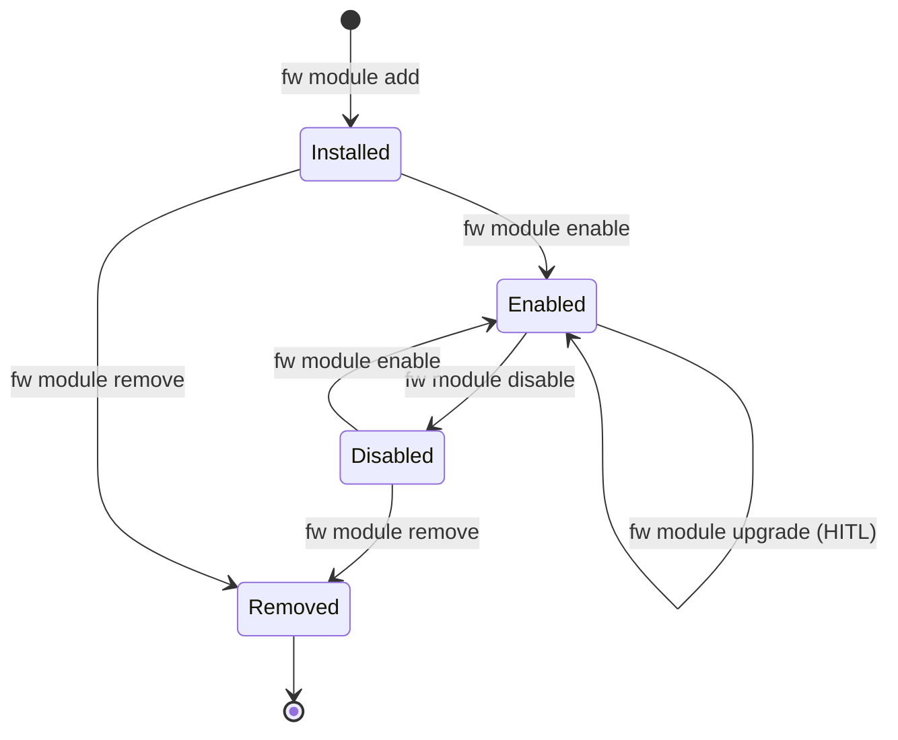

Rules:

1. `enable` succeeds only when all dependencies are enabled.
2. `disable` stops running tasks first. Then it releases agents, Skills, and Hooks.
3. You cannot `disable` a module that another enabled module depends on. The CLI shows the dependents.
4. `remove` deletes module code. Artifacts and Memory made by the module move to an archive. They are not deleted at once.
5. Enablement is set separately per company and per project. Example: only project A enables the App module.
6. When an owner module is disabled, its artifacts become read-only. Other modules do not edit them instead.
7. Core Services (§6.5) do not follow this lifecycle. They are always on.

### 7.3 Extension Points

| Extension point | Description |
|---|---|
| Stack packs | App, Server, and Frontend modules have packs per language. Example: `server.kotlin`, `server.go` |
| Hook slots | Modules attach Hooks only to fixed slots (task start, before tool call, before completion). |
| MCP tools | Modules add tools with their own MCP servers. Permissions go in the manifest. |

## 8. Orchestrator Design

### 8.1 Separation of Roles

| Item | Platform Orchestrator | Project Orchestrator |
|---|---|---|
| Scope | Whole company | One project |
| Count | 1 | 1 per project |
| Main work | Create and stop projects, run Company modules, allocate resources and budget, improve the Platform harness | Run work from planning to operations, coordinate Project modules, report risk |
| Modules run | Company modules, Memory modules | Project modules |
| Reports to | Founder | Platform Orchestrator, Founder |

### 8.2 Work Flow

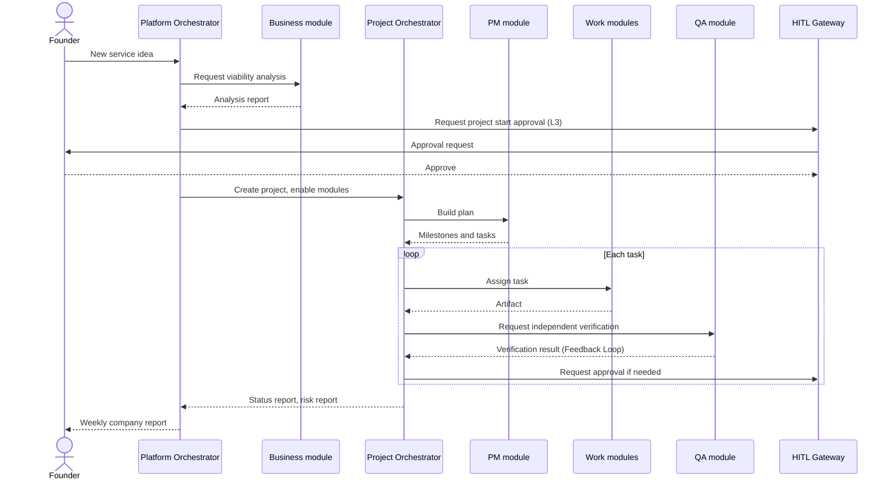

### 8.3 Task State Machine

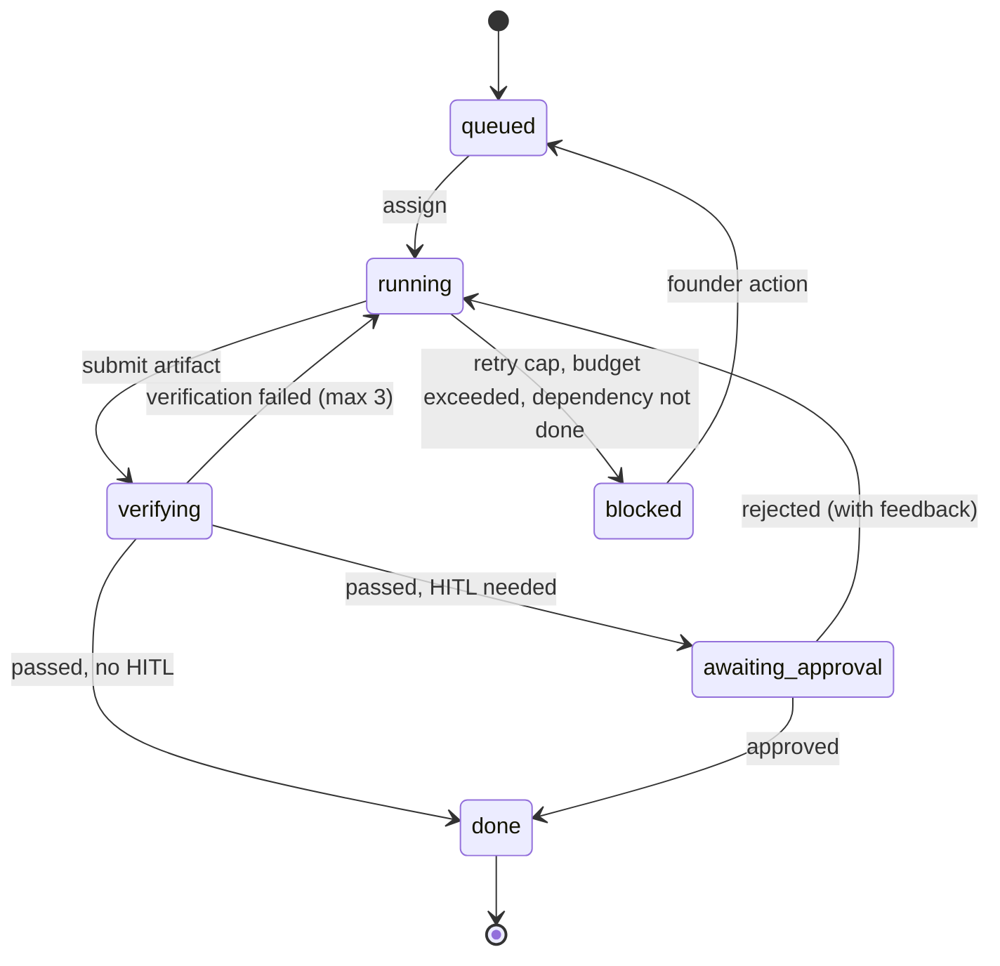

Rules:

1. Record every state transition in `state.db` first. Then run the external action.
2. Sending the same command again causes the side effect only once (idempotency key).
3. After 3 failed verifications, set the task to `blocked`. This prevents endless loops.
4. Each task has a budget cap. When the cap is reached, set the task to `blocked`.

## 9. Workflow Standard: Feedback Loop and HITL

### 9.1 Standard Workflow Skeleton

Every workflow follows this skeleton. Modules change only the content of the steps. They do not change the skeleton.

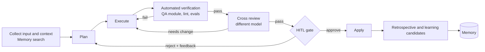

### 9.2 Three Levels of Feedback Loop

| Level | Cycle | Who | What it fixes |
|---|---|---|---|
| Task loop | One task | QA module, review agent | This artifact |
| Project loop | Milestone, retrospective | PM module, founder | Project plan, Wiki Memory |
| Company loop | Monthly, project end | Platform Orchestrator, Dreaming, founder | Harness, modules, Knowledge Memory |

### 9.3 HITL Levels

| Level | Name | Behavior | Example |
|---|---|---|---|
| L0 | Automatic | Record only. | Run tests, draft documents |
| L1 | Notify | Run and notify the founder. The founder can revert. | Push to a dev branch, Wiki draft |
| L2 | Approve | Run only after founder approval. | PRD approval, PR merge, knowledge promotion |
| L3 | Strong approval | Approve after re-authentication (passkey). The approval is single-use and bound to a content hash. | Production deploy, payment, external posting, secret change |

Rules:

1. Modules declare gate levels in the manifest. Platform policy enforces minimum levels.
2. If the content changes after approval, the approval is void.
3. A rejection needs a reason. The reason is stored as feedback and becomes input to the next run.
4. If an approval waits too long, the Console notifies the founder. Agents do other work while they wait.

(Reuses previous design [ADR-0006](draft/adr/0006-webauthn-approval.md) and [17 Feedback Loop](draft/17-feedback-loop.md).)

## 10. Memory Design

### 10.1 Stores

| Store | Scope | Examples | Write rights |
|---|---|---|---|
| Knowledge | Company | Coding rules, security standards, brand principles, architecture patterns, cost standards | Only through promotion |
| Wiki | Project | Domain terms, PRD summary, ADR list, retrospectives, incident records | Agents propose. The founder or PM confirms. |
| Task log | Task | Checkpoints, run logs | System writes. Cleaned up after the retention period. |

### 10.2 Record Fields

Every Memory record has these fields.

| Field | Meaning |
|---|---|
| `scope` | `company` or `project:{id}` |
| `kind` | fact, decision, rule, pattern, lesson |
| `trust` | `founder`, `verified`, `agent`, `external` |
| `source` | Evidence link (task, PR, document) |
| `status` | `proposed`, `active`, `deprecated` |
| `valid_until` | Review date |

Agents cannot set `trust` or `status`. The server sets them. Recalled Memory is reference material, not a command.

### 10.3 Promotion Flow

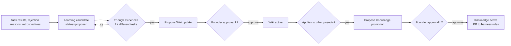

Automation only creates candidates. Only founder approval applies them. (Reuses previous design [ADR-0003](draft/adr/0003-human-promoted-learning.md).)

### 10.4 Dreaming Service

Dreaming is a batch job that runs while the founder rests (for example, early every morning).

| Job | Result |
|---|---|
| Find duplicates | Merge proposals |
| Find contradictions | Conflict report |
| Find stale knowledge | Review requests |
| Find patterns across projects | Knowledge promotion candidates |
| Analyze repeated rejection reasons | Harness and Skill improvement candidates |

Dreaming does not change Memory directly. All results go to the next day's approval queue.

## 11. Growing Harness

### 11.1 Two Harnesses

| Item | Platform harness | Project harness |
|---|---|---|
| Purpose | Builds and improves Flywheel itself. | Builds and improves a service. |
| Location | Flywheel repository | Project repository (created by the Platform) |
| Base | Written directly | Created by the Platform from a template; shared parts are synced |
| Contents | `AGENTS.md`, Skills, Hooks, evals, CI gates | Same, plus project-specific rules |

### 11.2 Harness Elements

| Element | Content |
|---|---|
| Instructions | `AGENTS.md` (source of truth), `CLAUDE.md` (Claude-specific additions) |
| Skills | Repeated procedures. Examples: write a PRD, write an ADR, add an API |
| Hooks | Fast feedback. Examples: LOC check, secret scan |
| Evals | Artifact quality tests. Examples: PRD required fields, tests pass |
| CI gates | Required checks before merge |

### 11.3 How It Grows

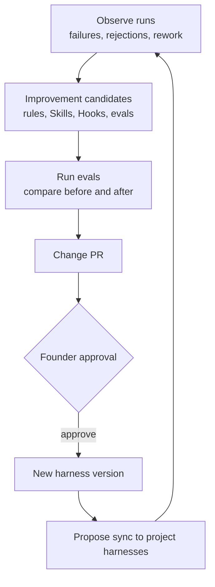

Rules:

1. Harnesses have versions. A running session stays on the version it started with.
2. Merge a harness change only when eval results do not get worse.
3. When shared parts of the Platform harness change, create a sync PR for each project. Do not overwrite project-specific parts.

## 12. Design System

### 12.1 Principles

1. The design SSOT is HTML. Figma, Pixso, and Penpot are not the source of truth.
2. Build the design system with Atomic Design.
3. Split tokens into 3 levels: Primitive → Semantic → Component.
4. A project changes only the Primitive palette. Semantic tokens and components are shared.

### 12.2 Structure

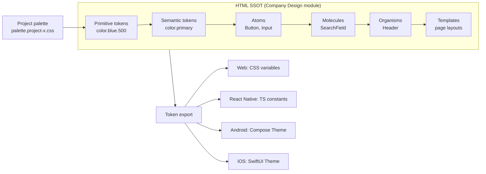

### 12.3 Applying a Project Palette

```css
/* tokens/semantic.css (shared) */
:root {
  --color-primary: var(--palette-brand-500);
  --color-on-primary: var(--palette-neutral-0);
}

/* palettes/project-x.css (per project) */
[data-project="project-x"] {
  --palette-brand-500: #2f6bff;
  --palette-neutral-0: #ffffff;
}
```

### 12.4 Artifacts

| Artifact | Description |
|---|---|
| Component catalog | Static HTML site that shows every component and state |
| Token files | CSS variables. The export tool converts them to each platform format. |
| Screen drafts | HTML screens that the UI/UX module builds from catalog components |
| Visual regression tests | Component screenshot comparison (Playwright) |

## 13. Development Architecture Principles

These principles apply to the Flywheel Platform and to every project.

### 13.1 Clean Architecture

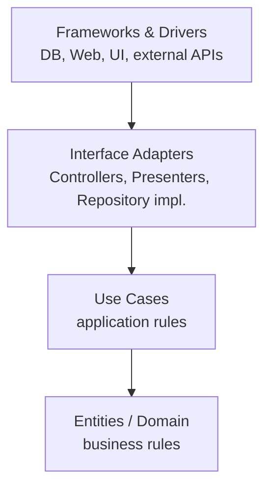

1. Dependencies point only from outside to inside.
2. The Domain does not know frameworks.
3. CI checks dependency direction. Examples: dependency-cruiser (TS), ArchUnit or Konsist (Kotlin), go-arch-lint (Go), import-linter (Python).

### 13.2 When to Apply DDD

DDD is the default. Use these criteria to set the level. The Architecture module records the decision in an ADR.

| Service type | Level |
|---|---|
| Complex business rules. Several subdomains. | Strategic + tactical design (Bounded Context, Aggregate, Domain Event) |
| Medium business rules. | Strategic design only (Bounded Context, ubiquitous language) |
| CRUD-focused, static site, or experiment. | No DDD. Keep only Clean Architecture layers. |

### 13.3 Function Length Rule

| Length | Handling |
|---|---|
| 25 LOC or less | Allowed |
| 26–50 LOC | Allowed. A reason comment above the function is required. |
| 51 LOC or more | Not allowed. The merge is blocked. |

The reason comment has this format. The checker accepts only this format.

```kotlin
// LOC-EXCEPTION: The state transition table is easier to read in one place. Splitting it scatters the flow.
fun transition(state: State, event: Event): State { /* ... */ }
```

Enforcement has 3 steps.

1. **Hook**: Checks immediately when an agent writes a file. Reports violations.
2. **CI**: Checks every PR. Fails on 51+ LOC or on 26–50 LOC without a reason.
3. **Review**: The review agent checks that the reason comment is valid.

Tools per language (proposed). Languages without a tool use the shared checker (`fw lint loc`).

| Language | Tool |
|---|---|
| TypeScript / JavaScript | ESLint `max-lines-per-function` + custom rule |
| Kotlin | detekt `LongMethod` + custom rule |
| Swift | SwiftLint `function_body_length` |
| Go | golangci-lint `funlen` |
| Python | Shared checker (`ast`-based) |

Set one LOC counting rule (blank lines, comments, signature) in Phase 0.

## 14. Repository Structure (proposed)

```text
flywheel/
├── AGENTS.md                 # Platform harness instructions (source of truth)
├── apps/
│   ├── cli/                  # fw CLI
│   └── console/              # Founder Console (Next.js)
├── packages/
│   ├── core/                 # Control Plane: state, policy, budget
│   ├── orchestrator/         # Platform / Project Orchestrator
│   ├── registry/             # Module Registry
│   ├── memory/               # Memory Service
│   ├── hitl/                 # HITL Gateway
│   ├── core-services/        # config audit, budget router, eval manager, integrations
│   └── harness-adapters/     # Claude Code, Codex adapters
├── modules/
│   ├── company/              # finance, business, branding, legal, ...
│   ├── project/              # pm, planning, architecture, qa, release, ai, ...
│   └── memory/               # knowledge, wiki, dreaming
├── design-system/            # HTML SSOT, tokens, catalog
├── templates/
│   ├── project-harness/      # project harness template
│   └── docs/                 # PRD, ADR, Tech Spec templates
├── docs/                     # Platform documents (STE-KO)
└── evals/                    # harness and module evals
```

## 15. Documentation Standard (STE-KO)

### 15.1 Writing Rules

Apply ASD-STE100 principles adapted for Korean. Confirm the detailed rules in `docs/ste-ko.md` during Phase 0.

1. Write one idea per sentence.
2. Descriptive sentences have 25 words (eojeol) or fewer. Instructions have 20 or fewer.
3. Put the conclusion and the actor first.
4. Use active voice.
5. Use one term for one concept. Register terms in the glossary.
6. Write instructions as imperative sentences. One action per step.
7. Do not use vague words ("appropriately", "if possible", "etc.").
8. Add a Mermaid diagram to content with structure, flow, or state.

### 15.2 Document Templates

| Template | Owner module | Required items |
|---|---|---|
| PRD | Planning | Problem, target users, goals and metrics, scope and non-scope, user flows, requirements, launch criteria |
| ADR | Architecture | Status, context, decision, alternatives, consequences |
| Technical Spec | Architecture | Structure diagram, data model, API, error handling, test plan, security notes |
| Threat model | Security | Assets, trust boundaries, threats (STRIDE), mitigations |
| Runbook | DevOps | Symptom, how to check, action, rollback |

### 15.3 Document Checks

CI also checks documents. It checks sentence length, banned words, glossary violations, and Mermaid syntax. (Consider reusing [lint_docs.py](draft/evidence/lint_docs.py) and [check_mermaid.mjs](draft/evidence/check_mermaid.mjs) from the previous design.)

## 16. Roadmap

Move to the next phase by exit criteria, not by dates. Estimate time after the founder confirms available hours (Q-01).

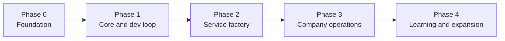

| Phase | Scope | Exit criteria |
|---|---|---|
| Phase 0 Foundation | Minimal Platform harness, STE-KO rules, LOC checker, module manifest schema, repo and CI setup, sandbox check | The LOC checker blocks violating PRs in CI. Manifest schema checks work. |
| Phase 1 Core and dev loop | Control Plane, task state machine, Module Registry (with `owns` check), HITL Gateway (L0–L2), minimal Project Orchestrator, Memory (Knowledge and Wiki store and search), Core Services (config audit, budget router, minimal eval manager), 8 modules: PM, Planning, Architecture, Server, Frontend, QA, Security, Finance (cost ledger) | One project completes PRD → ADR/Spec → build → QA verification → merge with approval gates. |
| Phase 2 Service factory | Platform Orchestrator, project creation template, Design System (HTML SSOT, token export), Integration Manager, modules: UI/UX, App, DBA, DevOps, Branding, Business, Legal & Privacy, Release, AI Features; HITL L3, Founder Console | A new project is ready within one day. One reference service deploys with legal documents and rolls back. |
| Phase 3 Company operations | Marketing and Analytics modules, multi-project operations, weekly company report, harness sync | Two or more projects run at the same time. The weekly report is generated automatically. |
| Phase 4 Learning and expansion | Dreaming, vector search, automatic harness improvement candidates, CS module | Measure the approval rate of Dreaming candidates. Harness improvements raise eval scores. |

The first build target is Flywheel itself. From Phase 1, the Platform builds itself (dogfooding). This matches previous design [ADR-0008](draft/adr/0008-platform-first.md).

## 17. Risks and Mitigations

| ID | Risk | Impact | Mitigation |
|---|---|---|---|
| R-01 | Scope is too wide. There are 24 modules. | The Platform is not finished. The old problems (PB-01–04) repeat. | Split modules by phase. Phase 1 builds only 8 modules. Others get only a manifest and an empty shell. Add new functions to existing modules first (§6.4). |
| R-02 | An agent merges a wrong change. | Lower service quality, security incident | Keep merge and deploy rights outside agents. Enforce HITL L2 and L3. |
| R-03 | Polluted knowledge becomes a rule. | Wrong rules spread to all projects. | Allow only trust levels, evidence conditions, and human promotion. |
| R-04 | AI cost grows. | Financial burden | Put the Finance budget ledger and Budget Router in Phase 1. Set per-task caps. |
| R-05 | Too many approval requests. | Founder time runs out; approval fatigue | Measure and tune gate levels. Support batch approval. Watch KPI-03. |
| R-06 | External tools (such as Claude Code) change behavior. | Hooks or adapters break | Wrap them with the Harness Adapter. Keep contract tests per version. |
| R-07 | The LOC rule causes harmful splits. | Meaningless small functions increase. | The review agent checks split quality. Allow exception comments. |
| R-08 | HTML SSOT is hard to move to native apps. | Design differences across platforms | Export only tokens automatically. Build components per platform and compare with visual regression. |
| R-09 | Module responsibilities overlap. | Agents make the same artifact differently. Two sources of truth appear. | One owner module per artifact (§6.6). The Registry rejects duplicate ownership. |
| R-10 | AI-written legal documents are published as-is. | Legal disputes, store review rejection | Mark legal documents as "draft". Publish high-risk issues only after an external expert check (HITL L3). |

## 18. Open Decisions

| ID | Question | Default (proposed) |
|---|---|---|
| Q-01 | How many hours per week does the founder have? | 20 hours/week, from the previous design |
| Q-02 | How much of the previous design ([draft/](draft/README.md)) carries over? | Keep the security boundary, approval, and Memory promotion decisions. Follow this plan for module structure. |
| Q-03 | Is the command `fw` or the previous `ax`? | `fw` (matches the product name Flywheel) |
| Q-04 | Is the Platform implementation language TypeScript? | TypeScript |
| Q-05 | What is the first reference service? | Decide with the Business module before Phase 2. |
| Q-06 | What is the monthly AI and infrastructure budget cap? | Undecided. Decide in Phase 0. |
| Q-07 | Does it start on a single local machine? | Yes. Same as previous design [ADR-0001](draft/adr/0001-local-control-plane.md). |
| Q-08 | Does LOC include blank lines and comments? | No. Count only code lines from the signature to the closing brace. |
| Q-09 | When do legal documents need an external expert review? | Always for payments, sensitive data, location data, and services for children. |
| Q-10 | What is the default model provider for the AI Features module? | Claude API. Each service can switch after comparison evals. |

## 19. Relation to the Previous Design

The `draft/` folder in this repository holds detailed design v1, made from an earlier request document. This plan follows the new request document ([request-draft.md](request-draft.md)).

| Previous design | Handling in this plan |
|---|---|
| Trust boundary; Hooks are not the boundary (ADR-0002) | Carried over (§5.2) |
| Human-promoted learning (ADR-0003) | Carried over (§10.3) |
| Passkey approval (ADR-0006) | Carried over as HITL L3 (§9.3) |
| Business function modules (ADR-0010, chapter 14) | Reorganized into 9 Company modules. Legal & Privacy is a new module; monetization, assets, and company operations become responsibilities of existing modules (§6.1, §6.4) |
| Roles A13 QA, A16 AgentShield audit | Carried over as the QA module and Agent Config Audit (Core Services) (§6.2, §6.5) |
| Service Type A–D packs | Reorganized into stack packs and project templates (§7.3) |
| Feedback loop (ADR-0013) | Expanded into a 3-level loop (§9.2) |
| Roadmap P0–P3 | Re-split into Phase 0–4 (§16) |

## Appendix A. Requirement Traceability

| request-draft.md item | Plan section |
|---|---|
| 8 Company modules | §6.1 |
| 9 Project modules | §6.2 |
| (Added after review) 4 modules, moved responsibilities, Core Services, module boundaries | §6, §6.4–§6.6 |
| 3 Memory modules | §6.3, §10 |
| AI Native Platform and management tool | §4, §5, §8 |
| Platform growing harness | §11 |
| Project growing harness | §11 |
| Memory service | §10 |
| Add, remove, enable, disable modules | §7 |
| Feedback Loop and HITL | §9 |
| Platform and Project Orchestrators | §8 |
| STE-KO documents and diagrams | §15 |
| HTML design SSOT, atomic, project palettes | §12 |
| Clean Architecture, DDD (optional) | §13.1, §13.2 |
| 25/50 LOC function rule | §13.3 |

## Appendix B. Next Steps

1. The founder answers the open decisions in §18.
2. Review this plan and revise it to v0.3.
3. Estimate the detailed task list and hours for Phase 0.
4. Build the module manifest JSON Schema and the LOC checker first.
