# Flywheel Platform 구축 계획서 (초안)

| 항목 | 내용 |
|---|---|
| 문서 상태 | 초안 v0.2 (검토 필요) |
| 작성일 | 2026-11-27 |
| 수정일 | 2026-11-28 (모듈 카탈로그 검토 반영) |
| 입력 문서 | [request-draft.md](request-draft.md) |
| 참고 자료 | [draft/](draft/README.md) (이전 상세 설계 v1) |
| 작성 규칙 | STE-KO (§15). 영어판: [plan-draft.en.md](plan-draft.en.md) |

**결론: Flywheel은 1인 기업을 AI 에이전트 조직으로 운영하는 플랫폼이다. Company, Project, Memory의 3개 계층에 모듈 24개를 둔다. 모듈마다 소유하는 산출물을 정해 경계가 겹치지 않게 한다. 모든 모듈은 같은 계약으로 설치하고, 켜고, 끄고, 지운다. 2개의 Orchestrator가 작업을 나누어 실행한다. 모든 Workflow는 Feedback Loop와 HITL 관문을 가진다. 구축은 5단계로 진행한다. 첫 단계는 Platform 하네스와 모듈 계약이다.**

---

## 1. 배경과 문제

1인 개발자는 여러 서비스를 만들고 운영하려 한다. 그러나 다음 문제로 서비스를 끝까지 완성하지 못했다.

| ID | 문제 | 결과 |
|---|---|---|
| PB-01 | 프로젝트마다 하네스를 새로 만든다. | 같은 작업을 반복한다. |
| PB-02 | 브랜딩, 마케팅, 디자인, 비용을 프로젝트마다 따로 처리한다. | 일이 흩어지고 빠진다. |
| PB-03 | 지난 프로젝트에서 배운 것을 다음 프로젝트에 옮기지 못한다. | 같은 실수를 반복한다. |
| PB-04 | 진행 상태와 위험을 한곳에서 보지 못한다. | 프로젝트가 멈춰도 알지 못한다. |

Flywheel은 이 문제를 "1인 기업"의 구조로 푼다. 회사 공통 기능은 Company 모듈로 만든다. 프로젝트 기능은 Project 모듈로 만든다. 지식은 Memory 모듈에 쌓는다. 한 프로젝트가 끝날 때마다 회사의 능력이 커진다. 이 순환이 "Flywheel"이다.


## 2. 목표, 비목표, 성공 지표

### 2.1 목표

| ID | 목표 |
|---|---|
| G-01 | 1인 기업을 운영하는 Company 모듈을 제공한다. |
| G-02 | 프로젝트를 기획, 설계, 구현, 운영하는 Project 모듈을 제공한다. |
| G-03 | 회사 지식과 프로젝트 지식을 쌓고 개선하는 Memory 모듈을 제공한다. |
| G-04 | Platform과 Project가 스스로 개선되는 성장형 하네스를 제공한다. |
| G-05 | 창업자가 한 화면에서 모든 프로젝트를 보고 판단하게 한다. |

### 2.2 비목표 (v1 범위 밖)

- 여러 사람이 함께 쓰는 협업 기능은 만들지 않는다.
- 자체 AI 모델은 학습하지 않는다.
- 범용 워크플로 엔진(예: Airflow 대체)은 만들지 않는다.
- 에이전트가 사람의 승인 없이 프로덕션을 바꾸게 하지 않는다.

### 2.3 성공 지표 (제안)

수치는 **제안**이다. Phase 1에서 기준선을 측정한 뒤 확정한다.

| ID | 지표 | 계산식 | 목표 |
|---|---|---|---|
| KPI-01 | 새 프로젝트 준비 시간 | 프로젝트 생성부터 첫 PRD 승인까지 걸린 시간 | 1일 이하 |
| KPI-02 | 공통 모듈 재사용률 | 재사용한 모듈 수 ÷ 프로젝트가 쓴 모듈 수 | 70% 이상 |
| KPI-03 | 창업자 관리 시간 | 승인, 검토, 판단에 쓴 주간 시간 | 주 5시간 이하 |
| KPI-04 | 피드백 반영률 | 닫은 피드백 수 ÷ 받은 피드백 수 (30일) | 80% 이상 |
| KPI-05 | 프로젝트 완료율 | 출시한 프로젝트 수 ÷ 시작한 프로젝트 수 | 기준선 대비 증가 |
| KPI-06 | 규칙 위반 병합 | LOC, 아키텍처 규칙을 어긴 채 병합된 PR 수 | 0건 |

반대 지표도 본다. 승격된 지식의 "양"은 목표로 쓰지 않는다. 양을 목표로 쓰면 품질이 낮은 지식이 늘어난다.

## 3. 요구사항

### 3.1 기능 요구사항

| ID | 요구사항 | 출처 | 반영 |
|---|---|---|---|
| FR-01 | AI Native 방식으로 여러 프로젝트를 운영하는 Platform과 관리 도구를 만든다. | 요구사항 1 | §5, §6 |
| FR-02 | Platform을 만들고 개선하는 성장형 하네스를 만든다. | 요구사항 2 | §11 |
| FR-03 | 프로젝트를 만들고 개선하는 성장형 하네스를 만든다. | 요구사항 3 | §11 |
| FR-04 | 회사와 프로젝트 지식을 쌓고 개선하는 Memory 서비스를 만든다. | 요구사항 4 | §10 |
| FR-05 | 모듈을 추가, 제거, 활성화, 비활성화할 수 있다. | 요구사항 5 | §7 |
| FR-06 | 모든 Workflow에 Feedback Loop와 HITL을 넣는다. | 요구사항 6 | §9 |
| FR-07 | Platform Orchestrator와 Project Orchestrator를 둔다. | 요구사항 7 | §8 |
| FR-08 | 모든 문서는 STE-KO로 쓰고 다이어그램을 넣는다. | 요구사항 8 | §15 |
| FR-09 | 디자인 SSOT는 HTML로 만든다. 디자인 시스템은 Atomic 구조이고 프로젝트별 팔레트를 적용한다. | 요구사항 9 | §12 |
| FR-10 | Clean Architecture와 DDD를 기본으로 쓴다. DDD는 서비스에 따라 생략한다. | 요구사항 10 | §13 |
| FR-11 | 함수는 25 LOC 이하로 쓴다. 25~50 LOC는 이유를 적는다. 50 LOC 초과는 분리한다. | 요구사항 10 | §13.3 |

### 3.2 비기능 요구사항 (제안)

| ID | 요구사항 | 측정 |
|---|---|---|
| NFR-01 | 에이전트는 프로덕션 자격증명을 가지지 않는다. | 샌드박스에서 비밀값 조회가 실패한다. |
| NFR-02 | 프로세스가 중단되어도 완료된 작업 상태를 잃지 않는다. | 강제 종료 시험에서 손실 0건 |
| NFR-03 | 모듈을 끄면 그 모듈의 에이전트, Skill, Hook이 모두 멈춘다. | 비활성화 후 호출 시험 |
| NFR-04 | 월 AI 비용이 예산 상한을 넘지 않는다. | 예산 원장 |
| NFR-05 | Memory 검색은 1만 건에서 p95 200ms 이하다. | 벤치마크 |
| NFR-06 | 모든 고위험 작업은 창업자 승인 기록을 가진다. | 감사 로그 |

## 4. 개념 모델

Flywheel은 회사를 3개 계층으로 본다. 각 계층은 모듈의 집합이다.

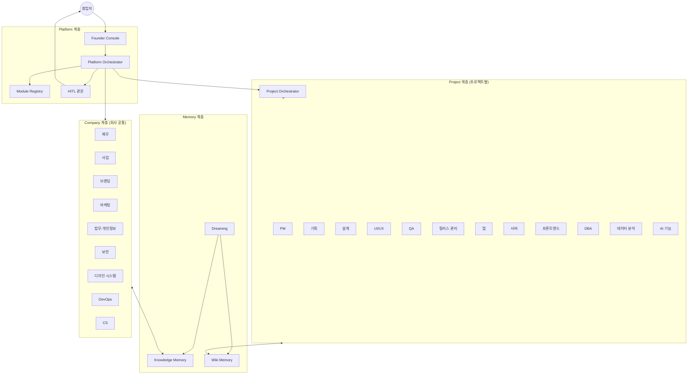

### 4.1 핵심 용어

| 용어 | 뜻 |
|---|---|
| 모듈 | 하나의 업무 기능 묶음이다. 에이전트 역할, Skill, Workflow, 템플릿, Memory 범위를 가진다. |
| Company 모듈 | 회사 전체에 하나만 있는 모듈이다. 모든 프로젝트가 함께 쓴다. |
| Project 모듈 | 프로젝트마다 하나씩 생기는 모듈 인스턴스다. |
| Orchestrator | 작업을 나누고, 순서를 정하고, 결과를 모으는 실행기다. |
| 하네스 | 에이전트를 실행하는 규칙, 도구, Hook, 평가의 묶음이다. |
| HITL 관문 | 사람이 확인해야 다음 단계로 가는 지점이다. |
| Feedback Loop | 결과를 평가하고 그 결과로 다음 실행을 고치는 순환이다. |
| SSOT | 하나의 정보에 하나의 정본만 둔다는 원칙이다. |

### 4.2 모듈의 구성

모든 모듈은 같은 6개 요소를 가진다.

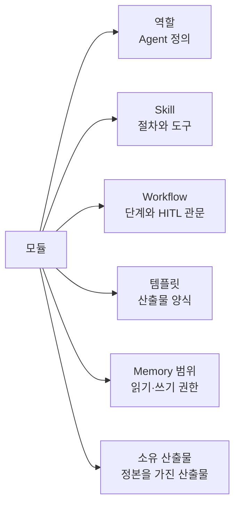

하나의 산출물에는 소유 모듈이 하나만 있다. 다른 모듈은 그 산출물을 읽거나 변경을 요청한다. 직접 고치지 않는다(§6.6).

## 5. 시스템 아키텍처

### 5.1 구성 요소

| 구성 요소 | 책임 |
|---|---|
| `fw` CLI | 창업자와 Orchestrator가 쓰는 명령줄 도구다. |
| Founder Console | 웹 대시보드다. 진행 상황, 승인 대기, 비용, 위험을 보여 준다. |
| Control Plane (`fw-core`) | 작업 상태, 권한, 승인, 예산을 결정한다. 에이전트 밖에서 실행한다. |
| Module Registry | 모듈 목록, 버전, 상태(활성/비활성)를 관리한다. |
| Platform Orchestrator | 회사 단위 작업과 프로젝트 생성을 실행한다. |
| Project Orchestrator | 프로젝트 하나의 작업 흐름을 실행한다. |
| Harness Adapter | Claude Code, Codex 같은 에이전트 도구를 같은 방식으로 호출한다. |
| Memory Service | Knowledge, Wiki 저장소와 검색, 승격을 담당한다. |
| HITL Gateway | 승인 요청을 만들고, 창업자 응답을 검증하고, 기록한다. |
| Sandbox | 에이전트가 실행되는 격리 환경이다. 비밀값이 없다. |
| Core Services | 에이전트 설정 감사, 평가 관리, 예산·모델 라우터, 연동 관리다. 끌 수 없다(§6.5). |

### 5.2 신뢰 경계

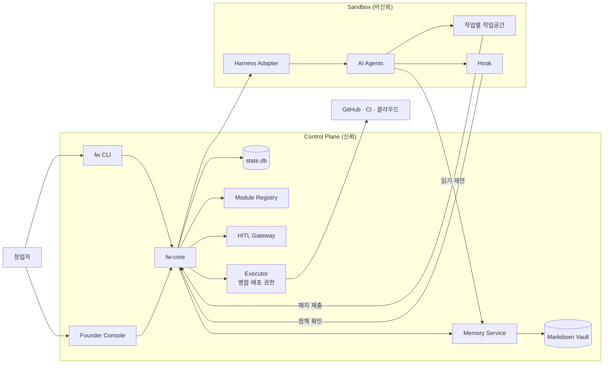

규칙은 다음과 같다.

1. 에이전트는 비신뢰 작업자다.
2. 에이전트는 제안만 한다. 병합과 배포는 Executor가 한다.
3. Executor는 HITL 승인 기록을 확인한 뒤에만 실행한다.
4. Hook은 빠른 피드백 장치다. 최종 보안 경계가 아니다. 최종 경계는 샌드박스, 자격증명 부재, 병합 게이트다. (이전 설계 [ADR-0002](draft/adr/0002-hooks-not-boundary.md) 재사용)

### 5.3 기술 스택 (제안)

| 영역 | 제안 | 이유 |
|---|---|---|
| Control Plane, CLI | TypeScript (Node.js) | Console과 언어를 같게 한다. MCP SDK 지원이 좋다. |
| 상태 저장 | SQLite (WAL) | 1인 로컬 운영에 충분하다. 백업이 쉽다. |
| Memory 정본 | SQLite + FTS, 파생본은 Markdown Vault | 검색과 사람 편집을 모두 지원한다. |
| 벡터 검색 | `sqlite-vec` (Phase 3) | 별도 서버가 없다. |
| Console | Next.js | 프론트엔드 모듈의 기본 스택과 같다. |
| 에이전트 하네스 | Claude Code (주), Codex (교차 리뷰) | 구독으로 쓸 수 있다. Hook, Skill, MCP를 지원한다. |
| 도구 연결 | MCP 서버 | 모듈의 도구를 표준 방식으로 노출한다. |
| 코드 저장소 | GitHub 모노레포 + 프로젝트별 저장소 | 브랜치 보호와 CI를 병합 게이트로 쓴다. |

## 6. 모듈 카탈로그

우선순위는 P1(먼저), P2(다음), P3(나중)이다. 우선순위는 **제안**이다.
v0.2에서 모듈 4개를 추가했다. 추가한 모듈은 "구분" 열에 **추가**로 표시한다. 나머지는 [request-draft.md](request-draft.md)의 모듈이다.

| 계층 | 요구 문서 | 추가 | 합계 |
|---|---:|---:|---:|
| Company | 8 | 1 | 9 |
| Project | 9 | 3 | 12 |
| Memory | 3 | 0 | 3 |
| 합계 | 20 | 4 | 24 |

### 6.1 Company 모듈

| 모듈 | 구분 | 책임 | 주요 산출물 | 주요 HITL 관문 | 우선순위 |
|---|---|---|---|---|---|
| 재무 (Finance) | 요구 | 비용과 수익을 기록하고 분석한다. AI, 클라우드, 구독 비용을 추적한다. 세무 의무 일정을 관리한다. | 월간 손익표, 예산 원장, 비용 경보, 구독 목록, 세무 달력 | 예산 상한 변경, 유료 서비스 가입·해지 | P1 |
| 사업 (Business) | 요구 | 서비스의 사업성을 분석한다. 사업 계획을 세운다. 수익 모델과 가격을 정한다. 여러 서비스의 포트폴리오를 관리한다. | 시장 분석, 사업 계획서, 가격표, 손익 시나리오, Go/No-Go 판단 자료 | 프로젝트 시작·보류·종료, 가격 확정 | P2 |
| 브랜딩 (Branding) | 요구 | 회사와 서비스의 브랜드를 설계하고 발전시킨다. | 브랜드 가이드, 네이밍 후보, 로고 시안, 톤앤매너 | 브랜드 확정 | P2 |
| 마케팅 (Marketing) | 요구 | 서비스를 홍보한다. 채널과 캠페인을 계획하고 결과를 분석한다. 스토어·랜딩 문구를 쓴다. | 출시 계획, 콘텐츠 초안, 스토어 문구, 캠페인 보고서 | 외부 게시, 광고비 집행 | P3 |
| 법무·개인정보 (Legal & Privacy) | **추가** | 약관, 개인정보 처리방침, 스토어 개인정보 항목을 만든다. 오픈소스 라이선스와 AI 사용 고지를 점검한다. 데이터 흐름을 기록한다. | 약관·처리방침 초안, 데이터 흐름도, 라이선스 점검표, 쟁점 목록 | 법무 문서 게시. 고위험 쟁점은 외부 전문가 확인 | P2 (첫 출시 전) |
| 보안 (Security) | 요구 | 취약점을 찾는다. 보안 기준을 정하고 검사한다. 계정, API 키, 도메인 같은 보안 자산을 관리한다. | 위협 모델, 취약점 보고서, 보안 체크리스트, 자산·계정 대장 | 위험 수용, 예외 승인, 키 교체 | P1 |
| 디자인 시스템 (Design) | 요구 | 회사 공통 디자인 시스템을 설계, 개발, 발전시킨다. | HTML 컴포넌트 카탈로그, 디자인 토큰 | 토큰·컴포넌트 변경 병합 | P1 |
| DevOps | 요구 | 배포와 운영 인프라를 설계하고 구축한다. 모니터링, 경보, 장애 대응 절차를 만든다. | IaC, CI/CD 파이프라인 템플릿, 관측 대시보드, 런북, 장애 사후 분석 | 인프라 변경 | P2 |
| CS | 요구 | 고객 문의에 응대한다. 도움말을 관리한다. | 응답 초안, FAQ·도움말, 문의 분류 보고서 | 고객에게 보내는 응답 | P3 (최하위) |

### 6.2 Project 모듈

| 모듈 | 구분 | 책임 | 주요 산출물 | 주요 HITL 관문 | 우선순위 |
|---|---|---|---|---|---|
| Project Manager | 요구 | 진행 현황과 위험을 분석한다. 프로젝트를 건강하게 유지한다. 창업자의 결정을 기록한다. | 마일스톤, 작업 보드, 주간 상태 보고, 위험 대장, 결정 로그 | 일정·범위 변경 | P1 |
| 기획 (Planning) | 요구 | 서비스를 분석하고 기획한다. | PRD | PRD 승인 | P1 |
| 설계 (Architecture) | 요구 | 기획을 구현할 구조를 설계한다. | ADR, Technical Spec | ADR·Spec 승인 | P1 |
| UI/UX 디자인 | 요구 | 사용성을 설계하고 화면을 디자인한다. 접근성을 점검한다. | 사용자 흐름, 와이어프레임, HTML 화면 시안, 접근성 점검표 | 화면 시안 승인 | P2 |
| 앱 개발 (App) | 요구 | 앱을 개발한다. React Native, Android(Kotlin), iOS(Swift)를 지원한다. | 앱 코드, 단위 테스트, 빌드 | 병합 | P2 |
| 서버 개발 (Server) | 요구 | 서버를 개발한다. Kotlin, Go, Python, Node를 지원한다. | API 코드, 단위 테스트, API 명세 | 병합 | P1 |
| 프론트엔드 개발 (Frontend) | 요구 | 웹 화면을 개발한다. Next.js, React, HTML+CSS를 지원한다. 다국어 리소스 구조를 만든다. | 웹 코드, 단위 테스트 | 병합 | P1 |
| DBA | 요구 | 데이터 구조를 설계하고 구축한다. | ERD, 스키마, 마이그레이션 | 프로덕션 마이그레이션 | P2 |
| 데이터 분석 (Analytics) | 요구 | 데이터를 수집하고 분석한다. | 이벤트 설계, 분석 보고서 | 수집 항목(개인정보) 확정 | P3 |
| QA (품질 검증) | **추가** | 수용 기준으로 시험을 설계하고 실행한다. 구현 모듈과 독립적으로 검증한다. 검증 증거를 남긴다. | 시험 계획, 통합·E2E 시험, 시각 회귀 결과, 검증 보고서 | 수용 판정 반려 | **P1** |
| 릴리스 관리 (Release) | **추가** | 버전, 변경 기록, 스토어 제출, 단계적 배포, 되돌리기를 관리한다. | 릴리스 노트, 릴리스 체크리스트, 스토어 제출 묶음, 되돌리기 기록 | 프로덕션 배포, 스토어 제출 (L3) | P2 |
| AI 기능 (LLM Engineering) | **추가** | 서비스의 AI 기능을 설계하고 개선한다. 프롬프트, 평가 세트, 모델 선택, 토큰 비용, 안전장치를 맡는다. | 프롬프트 정의, 평가 세트와 결과, 모델·비용 비교표, 안전 정책 | 모델 변경, 프롬프트 배포 | P2 |

### 6.3 Memory 모듈

| 모듈 | 책임 | 우선순위 |
|---|---|---|
| Knowledge Memory | 회사 공통 지식을 관리한다. 예: 코딩 규칙, 보안 기준, 브랜드 원칙, 재사용 패턴 | P1 |
| Wiki Memory | 프로젝트 지식을 관리한다. 예: 도메인 용어, 결정 기록, 회고, 장애 기록 | P1 |
| Dreaming | 쌓인 기록을 주기적으로 분석한다. 중복을 합치고, 모순을 찾고, 승격 후보를 만든다. | P3 |

### 6.4 기존 모듈에 넣은 책임

다음 기능은 새 모듈로 만들지 않는다. 기존 모듈의 책임으로 넣는다. 모듈 수를 늘리지 않기 위해서다.

| 기능 | 넣은 곳 | 내용 |
|---|---|---|
| 수익화·가격 | 사업 | 수익 모델, 가격 실험, 손익 시나리오 |
| 포트폴리오 관리 | 사업 + Platform Orchestrator | 서비스의 시작·보류·종료 판단, 자원 배분 |
| 자산·계정·구독 | 보안 (계정·키·도메인), 재무 (구독·갱신 비용) | 소유 자산 목록, 갱신 일정, 해지 절차 |
| 세무·신고 일정 | 재무 | 부가세, 종합소득세, 사업자 의무 달력 |
| 창업자 시간·결정 기록 | PM + Founder Console | 주간 검토, 결정 로그, 승인 부담(KPI-03) |
| 운영·장애 대응 (SRE) | DevOps | 모니터링, 경보, 장애 기록, 사후 분석. 장애 기록은 Wiki Memory에 넣는다. |
| 접근성 | UI/UX | 접근성 기준과 점검 |
| 다국어 | 프론트엔드, 앱 개발 | 다국어 리소스 구조 |
| 스토어·랜딩 문구 | 마케팅 | 문구 초안. 게시는 HITL L3 |
| 도움말 | CS | FAQ와 도움말 문서 |

### 6.5 Platform Core Services

다음 기능은 모듈이 아니다. Platform 코어에 둔다. 끄면 안전장치가 사라지므로 비활성화할 수 없다.

| 서비스 | 책임 | 단계 |
|---|---|---|
| 에이전트 설정 감사 (Agent Config Audit) | 하네스, Hook, MCP, 권한 설정의 위험한 변경을 찾는다. 위험한 변경은 병합을 막는다. | Phase 1 |
| 예산·모델 라우터 (Budget Router) | 작업별로 모델을 고른다. 작업·월 비용 상한을 적용한다. 재무 모듈에 원장을 넘긴다. | Phase 1 |
| 평가 관리 (Eval Manager) | 하네스와 모듈의 평가 세트를 관리한다. 개선 전후 점수를 비교한다. | Phase 1 (최소판) |
| 연동 관리 (Integration Manager) | MCP 서버, 외부 서비스 연결, 비밀값 경로를 관리한다. 에이전트에는 비밀값을 주지 않는다. | Phase 2 |

### 6.6 모듈 경계

책임이 겹치는 모듈은 다음 규칙을 따른다. 기본 원칙은 "정본 소유자는 하나, 나머지는 요청한다"이다.

| 겹치는 모듈 | 소유하는 쪽 | 사용하는 쪽 | 규칙 |
|---|---|---|---|
| 디자인 시스템 ↔ UI/UX | 디자인 시스템: 토큰, 컴포넌트 | UI/UX: 화면 시안 | UI/UX는 카탈로그 컴포넌트로 화면을 만든다. 새 컴포넌트가 필요하면 디자인 시스템에 요청한다. |
| 보안 ↔ 프로젝트 | 보안: 기준, 도구, 체크리스트 | 각 프로젝트 | 프로젝트별 보안 검사는 보안 모듈의 Project 인스턴스로 실행한다. 별도 프로젝트 보안 모듈은 없다. |
| DevOps ↔ 릴리스 관리 | DevOps: 인프라, 파이프라인 템플릿 | 릴리스 관리: 배포 실행 | 릴리스 관리는 DevOps 템플릿으로 배포한다. 인프라를 직접 바꾸지 않는다. |
| 데이터 분석 ↔ 회사 지표 | 사업: 회사 공통 지표 사전 | 데이터 분석: 프로젝트 분석 | 데이터 분석은 공통 지표 정의를 따른다. 새 지표는 사업 모듈에 등록을 요청한다. |
| 구현 모듈 ↔ QA | 구현 모듈: 단위 테스트 | QA: 통합·E2E 시험, 수용 판정 | 구현 모듈은 자신의 산출물을 수용 판정하지 않는다. |
| 사업 ↔ 재무 | 사업: 가격표, 손익 시나리오(계획) | 재무: 실제 수익·비용(실적) | 재무는 실적과 계획의 차이를 사업 모듈에 보고한다. |
| 법무·개인정보 ↔ 보안 | 법무: 문서, 데이터 흐름, 쟁점 | 보안: 기술 통제 | 법무가 데이터 흐름을 정의한다. 보안은 그 흐름에 맞는 통제를 검사한다. |
| AI 기능 ↔ 서버 개발 | AI 기능: 프롬프트, 평가 세트, 모델 선택 | 서버 개발: 호출 코드 | 서버 개발은 AI 기능의 정의를 코드에 연결한다. 프롬프트를 코드 안에서 고치지 않는다. |

모듈 매니페스트의 `owns` 필드에 소유 산출물을 적는다(§7.1). Module Registry는 두 모듈이 같은 산출물을 소유하면 등록을 거부한다.

## 7. 모듈 계약과 생명주기

### 7.1 모듈 매니페스트

모든 모듈은 `module.yaml` 파일을 가진다. Module Registry는 이 파일로 모듈을 등록한다.

```yaml
# modules/project/planning/module.yaml (예시)
id: project.planning
version: 0.1.0
layer: project            # company | project | memory
title: 기획
depends_on:
  - memory.wiki
  - company.business      # 선택 의존은 optional_depends_on에 쓴다
agents:
  - id: planner
    prompt: agents/planner.md
    tools: [read, write_docs, memory.search, memory.propose]
skills:
  - skills/write-prd/SKILL.md
workflows:
  - workflows/prd.yaml
templates:
  - templates/prd.md
memory:
  read: [knowledge/*, wiki/{project}/*]
  write_proposal: [wiki/{project}/planning/*]
owns:                     # 이 모듈이 정본을 가진 산출물 (§6.6)
  - docs/prd/*.md
hitl:
  - gate: prd.approve
    level: L2
evals:
  - evals/prd-quality.yaml
```

### 7.2 생명주기

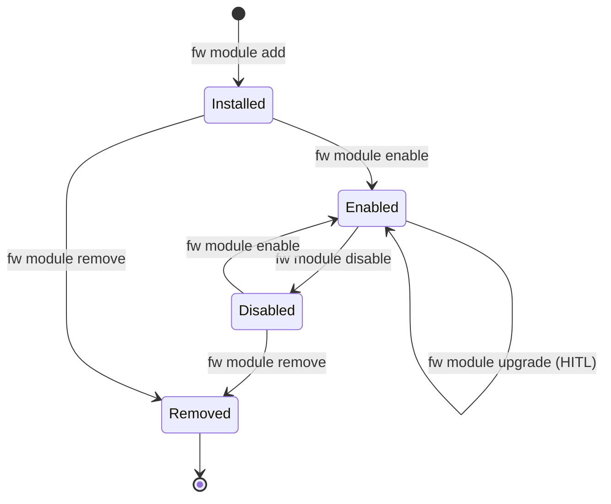

규칙은 다음과 같다.

1. `enable`은 의존 모듈이 모두 활성 상태일 때만 성공한다.
2. `disable`은 진행 중 작업을 먼저 멈춘다. 그다음 에이전트, Skill, Hook을 해제한다.
3. 다른 활성 모듈이 의존하는 모듈은 `disable`할 수 없다. CLI가 의존 목록을 보여 준다.
4. `remove`는 모듈 코드를 지운다. 모듈이 만든 산출물과 Memory는 보관함으로 옮긴다. 바로 지우지 않는다.
5. 모듈 활성화는 회사 단위와 프로젝트 단위로 따로 정한다. 예: 프로젝트 A만 앱 개발 모듈을 켠다.
6. 소유 모듈을 끄면 그 산출물은 읽기 전용이 된다. 다른 모듈이 대신 고치지 않는다.
7. Core Services(§6.5)는 이 생명주기를 따르지 않는다. 항상 켜져 있다.

### 7.3 확장 지점

| 확장 지점 | 설명 |
|---|---|
| 스택 팩 | 앱, 서버, 프론트엔드 모듈은 언어별 팩을 가진다. 예: `server.kotlin`, `server.go` |
| Hook 슬롯 | 모듈은 정해진 슬롯(작업 시작, 도구 호출 전, 완료 전)에만 Hook을 단다. |
| MCP 도구 | 모듈은 자체 MCP 서버로 도구를 추가한다. 권한은 매니페스트에 적는다. |

## 8. Orchestrator 설계

### 8.1 역할 분리

| 구분 | Platform Orchestrator | Project Orchestrator |
|---|---|---|
| 범위 | 회사 전체 | 프로젝트 하나 |
| 수 | 1개 | 프로젝트마다 1개 |
| 주요 작업 | 프로젝트 생성·중단, Company 모듈 실행, 자원·예산 배분, Platform 하네스 개선 | 기획부터 운영까지 작업 실행, Project 모듈 조정, 위험 보고 |
| 실행 모듈 | Company 모듈, Memory 모듈 | Project 모듈 |
| 보고 대상 | 창업자 | Platform Orchestrator, 창업자 |

### 8.2 작업 흐름

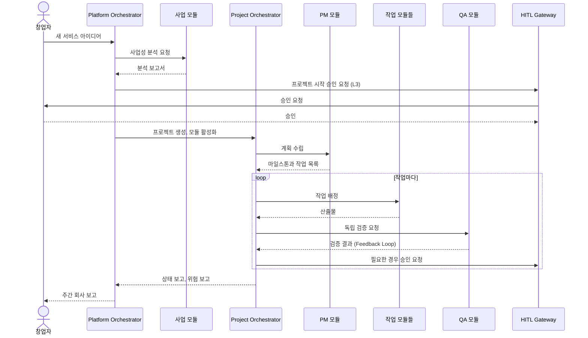

### 8.3 작업 상태 머신

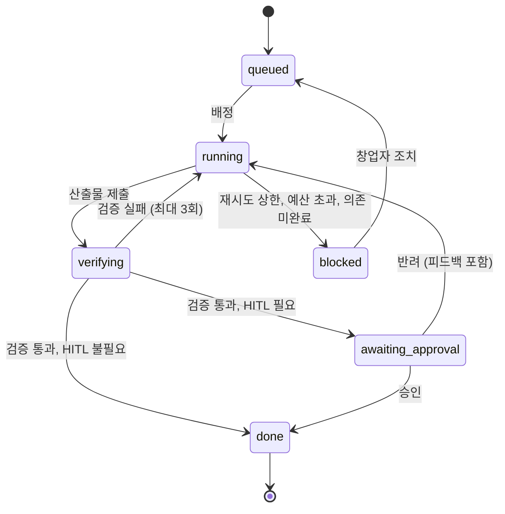

규칙은 다음과 같다.

1. 모든 상태 전이는 `state.db`에 먼저 기록한다. 그다음 외부 작업을 실행한다.
2. 같은 명령을 다시 보내도 부작용은 한 번만 생긴다(멱등 키).
3. 검증 실패가 3회를 넘으면 작업을 `blocked`로 바꾼다. 무한 반복을 막는다.
4. 작업마다 예산 상한을 둔다. 상한에 닿으면 `blocked`로 바꾼다.

## 9. Workflow 표준: Feedback Loop와 HITL

### 9.1 표준 Workflow 골격

모든 Workflow는 다음 골격을 따른다. 모듈은 단계의 내용만 바꾼다. 골격은 바꾸지 않는다.

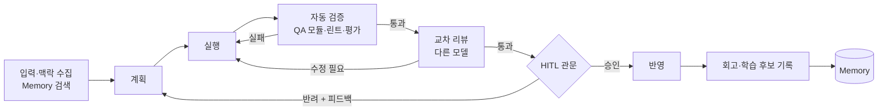

### 9.2 Feedback Loop의 3개 층

| 층 | 주기 | 누가 | 무엇을 고치나 |
|---|---|---|---|
| 작업 루프 | 작업 1건 | QA 모듈, 리뷰 에이전트 | 이번 산출물 |
| 프로젝트 루프 | 마일스톤, 회고 | PM 모듈, 창업자 | 프로젝트 계획, Wiki Memory |
| 회사 루프 | 월간, 프로젝트 종료 | Platform Orchestrator, Dreaming, 창업자 | 하네스, 모듈, Knowledge Memory |

### 9.3 HITL 수준

| 수준 | 이름 | 동작 | 예 |
|---|---|---|---|
| L0 | 자동 | 기록만 한다. | 테스트 실행, 문서 초안 작성 |
| L1 | 알림 | 실행하고 창업자에게 알린다. 창업자는 되돌릴 수 있다. | 개발 브랜치 푸시, Wiki 초안 |
| L2 | 승인 | 창업자가 승인해야 실행한다. | PRD 확정, PR 병합, 지식 승격 |
| L3 | 강한 승인 | 재인증(패스키) 후 승인한다. 승인은 1회용이고 내용 해시에 묶인다. | 프로덕션 배포, 결제, 외부 게시, 비밀값 변경 |

규칙은 다음과 같다.

1. 모듈은 매니페스트에 관문 수준을 적는다. Platform 정책은 최소 수준을 강제한다.
2. 승인 뒤에 내용이 바뀌면 승인은 무효다.
3. 반려에는 이유를 적는다. 이 이유는 피드백으로 저장되고 다음 실행의 입력이 된다.
4. 승인 대기가 길어지면 Console이 알린다. 에이전트는 기다리는 동안 다른 작업을 한다.

(이전 설계 [ADR-0006](draft/adr/0006-webauthn-approval.md), [17 피드백 루프](draft/17-feedback-loop.md) 재사용)

## 10. Memory 설계

### 10.1 저장소 구조

| 저장소 | 범위 | 내용 예 | 쓰기 권한 |
|---|---|---|---|
| Knowledge | 회사 | 코딩 규칙, 보안 기준, 브랜드 원칙, 아키텍처 패턴, 비용 기준 | 승격으로만 쓴다. |
| Wiki | 프로젝트 | 도메인 용어, PRD 요약, ADR 목록, 회고, 장애 기록 | 에이전트는 제안한다. 창업자 또는 PM이 확정한다. |
| 작업 기록 | 작업 | 체크포인트, 실행 로그 | 시스템이 쓴다. 보존 기간 뒤 정리한다. |

### 10.2 레코드 필드

모든 Memory 레코드는 다음 필드를 가진다.

| 필드 | 뜻 |
|---|---|
| `scope` | `company` 또는 `project:{id}` |
| `kind` | 사실, 결정, 규칙, 패턴, 교훈 |
| `trust` | `founder`, `verified`, `agent`, `external` |
| `source` | 근거 링크(작업, PR, 문서) |
| `status` | `proposed`, `active`, `deprecated` |
| `valid_until` | 재검토 날짜 |

에이전트는 `trust`와 `status`를 정할 수 없다. 서버가 정한다. 회상한 Memory는 명령이 아니라 참고 자료다.

### 10.3 승격 흐름

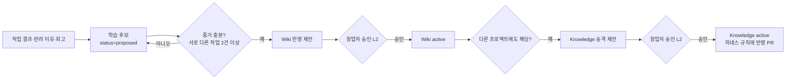

자동화는 후보만 만든다. 반영은 창업자 승인으로만 한다. (이전 설계 [ADR-0003](draft/adr/0003-human-promoted-learning.md) 재사용)

### 10.4 Dreaming 서비스

Dreaming은 창업자가 쉬는 동안(예: 매일 새벽) 실행하는 배치 작업이다.

| 작업 | 결과 |
|---|---|
| 중복 찾기 | 합치기 제안 |
| 모순 찾기 | 충돌 보고 |
| 오래된 지식 찾기 | 재검토 요청 |
| 프로젝트 간 공통 패턴 찾기 | Knowledge 승격 후보 |
| 반복된 반려 이유 분석 | 하네스·Skill 개선 후보 |

Dreaming은 Memory를 직접 바꾸지 않는다. 결과는 모두 다음 날 승인 대기열에 들어간다.

## 11. 성장형 하네스

### 11.1 2개의 하네스

| 구분 | Platform 하네스 | Project 하네스 |
|---|---|---|
| 목적 | Flywheel 자체를 만들고 개선한다. | 서비스를 만들고 개선한다. |
| 위치 | Flywheel 저장소 | 프로젝트 저장소 (Platform이 생성) |
| 기반 | 직접 작성 | Platform이 템플릿으로 생성하고 공통 부분을 동기화 |
| 구성 | `AGENTS.md`, Skill, Hook, 평가, CI 게이트 | 같음 + 프로젝트 전용 규칙 |

### 11.2 하네스의 구성 요소

| 요소 | 내용 |
|---|---|
| 지시 | `AGENTS.md` (정본), `CLAUDE.md` (Claude 전용 보충) |
| Skill | 반복 절차. 예: PRD 작성, ADR 작성, API 추가 |
| Hook | 빠른 피드백. 예: LOC 검사, 비밀값 검사 |
| 평가 (Eval) | 산출물 품질 시험. 예: PRD 필수 항목, 테스트 통과 |
| CI 게이트 | 병합 전 필수 검사 |

### 11.3 성장 방식

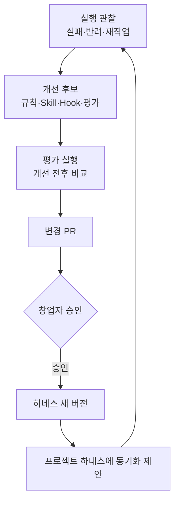

규칙은 다음과 같다.

1. 하네스는 버전을 가진다. 실행 중 세션은 시작한 버전에 고정한다.
2. 하네스 변경은 평가 결과가 나빠지지 않을 때만 병합한다.
3. Platform 하네스의 공통 부분이 바뀌면 각 프로젝트에 동기화 PR을 만든다. 프로젝트 전용 부분은 덮어쓰지 않는다.

## 12. 디자인 시스템

### 12.1 원칙

1. 디자인 SSOT는 HTML이다. Figma, Pixso, Penpot은 정본으로 쓰지 않는다.
2. 디자인 시스템은 Atomic Design 구조로 만든다.
3. 토큰은 3단계(Primitive → Semantic → Component)로 나눈다.
4. 프로젝트는 Primitive 팔레트만 바꾼다. Semantic 토큰과 컴포넌트는 공통으로 쓴다.

### 12.2 구조

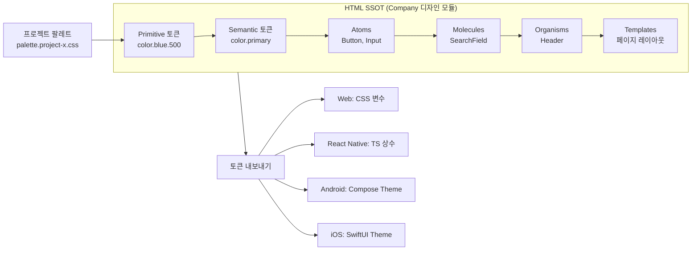

### 12.3 프로젝트 팔레트 적용

```css
/* tokens/semantic.css (공통) */
:root {
  --color-primary: var(--palette-brand-500);
  --color-on-primary: var(--palette-neutral-0);
}

/* palettes/project-x.css (프로젝트별) */
[data-project="project-x"] {
  --palette-brand-500: #2f6bff;
  --palette-neutral-0: #ffffff;
}
```

### 12.4 산출물

| 산출물 | 설명 |
|---|---|
| 컴포넌트 카탈로그 | 모든 컴포넌트와 상태를 보여 주는 정적 HTML 사이트 |
| 토큰 파일 | CSS 변수. 내보내기 도구가 각 플랫폼 형식으로 바꾼다. |
| 화면 시안 | UI/UX 모듈이 카탈로그 컴포넌트로 만든 HTML 화면 |
| 시각 회귀 시험 | 컴포넌트 스크린샷 비교 (Playwright) |

## 13. 개발 아키텍처 원칙

이 원칙은 Flywheel Platform과 모든 프로젝트에 적용한다.

### 13.1 Clean Architecture

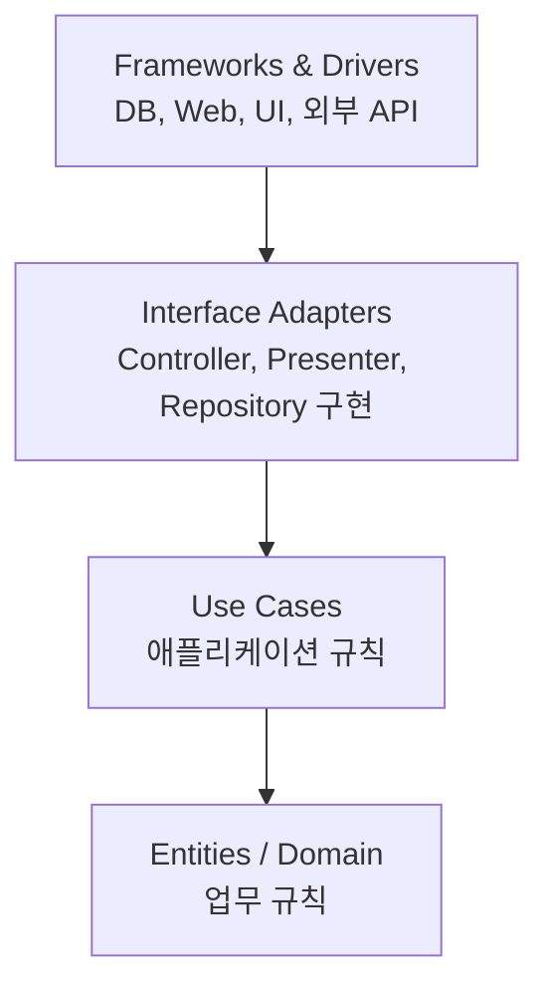

1. 의존은 바깥에서 안쪽으로만 향한다.
2. Domain은 프레임워크를 모른다.
3. 의존 방향은 CI에서 검사한다. 예: dependency-cruiser(TS), ArchUnit 또는 Konsist(Kotlin), go-arch-lint(Go), import-linter(Python).

### 13.2 DDD 적용 기준

DDD는 기본이다. 그러나 다음 기준으로 적용 수준을 정한다. 결정은 설계 모듈이 ADR로 기록한다.

| 서비스 성격 | 적용 수준 |
|---|---|
| 업무 규칙이 복잡하다. 여러 하위 도메인이 있다. | 전략 설계 + 전술 설계 (Bounded Context, Aggregate, Domain Event) |
| 업무 규칙이 중간이다. | 전략 설계만 (Bounded Context, 유비쿼터스 언어) |
| CRUD 중심이다. 정적 사이트다. 실험용이다. | DDD 생략. Clean Architecture 계층만 유지 |

### 13.3 함수 길이 규칙

| 길이 | 처리 |
|---|---|
| 25 LOC 이하 | 허용 |
| 26~50 LOC | 허용. 함수 위에 이유 주석이 반드시 있어야 한다. |
| 51 LOC 이상 | 금지. 병합을 막는다. |

이유 주석 형식은 다음과 같다. 검사기는 이 형식만 인정한다.

```kotlin
// LOC-EXCEPTION: 상태 전이 표를 한곳에 두어야 읽기 쉽다. 분리하면 흐름이 흩어진다.
fun transition(state: State, event: Event): State { /* ... */ }
```

집행은 3단계로 한다.

1. **Hook**: 에이전트가 파일을 쓰면 즉시 검사한다. 위반을 알린다.
2. **CI**: 모든 PR에서 검사한다. 51 LOC 이상 또는 이유 없는 26~50 LOC가 있으면 실패한다.
3. **리뷰**: 이유 주석이 타당한지 리뷰 에이전트가 확인한다.

언어별 도구(제안)는 다음과 같다. 도구가 없는 언어는 공통 검사기(`fw lint loc`)로 처리한다.

| 언어 | 도구 |
|---|---|
| TypeScript / JavaScript | ESLint `max-lines-per-function` + 사용자 규칙 |
| Kotlin | detekt `LongMethod` + 사용자 규칙 |
| Swift | SwiftLint `function_body_length` |
| Go | golangci-lint `funlen` |
| Python | 공통 검사기 (`ast` 기반) |

LOC 계산 기준(빈 줄, 주석, 시그니처 포함 여부)은 Phase 0에서 하나로 정한다.

## 14. 저장소 구조 (제안)

```text
flywheel/
├── AGENTS.md                 # Platform 하네스 지시 정본
├── apps/
│   ├── cli/                  # fw CLI
│   └── console/              # Founder Console (Next.js)
├── packages/
│   ├── core/                 # Control Plane: 상태, 정책, 예산
│   ├── orchestrator/         # Platform / Project Orchestrator
│   ├── registry/             # Module Registry
│   ├── memory/               # Memory Service
│   ├── hitl/                 # HITL Gateway
│   ├── core-services/        # 설정 감사, 예산 라우터, 평가 관리, 연동 관리
│   └── harness-adapters/     # Claude Code, Codex 어댑터
├── modules/
│   ├── company/              # finance, business, branding, legal, ...
│   ├── project/              # pm, planning, architecture, qa, release, ai, ...
│   └── memory/               # knowledge, wiki, dreaming
├── design-system/            # HTML SSOT, 토큰, 카탈로그
├── templates/
│   ├── project-harness/      # 프로젝트 하네스 템플릿
│   └── docs/                 # PRD, ADR, Tech Spec 양식
├── docs/                     # Platform 문서 (STE-KO)
└── evals/                    # 하네스·모듈 평가
```

## 15. 문서 표준 (STE-KO)

### 15.1 작성 규칙

ASD-STE100의 원칙을 한국어에 맞게 적용한다. 세부 규칙은 Phase 0에서 `docs/ste-ko.md`로 확정한다.

1. 한 문장에는 하나의 뜻만 쓴다.
2. 서술문은 25어절을 넘기지 않는다. 지시문은 20어절을 넘기지 않는다.
3. 결론과 행위자를 먼저 쓴다.
4. 능동형으로 쓴다. "~된다"보다 "~한다"를 쓴다.
5. 하나의 개념에는 하나의 용어만 쓴다. 용어는 용어집에 등록한다.
6. 지시는 명령형 문장으로 쓴다. 한 단계에 하나의 행동만 쓴다.
7. 모호한 말("적절히", "가능하면", "등")을 쓰지 않는다.
8. 구조, 흐름, 상태가 있는 내용에는 Mermaid 다이어그램을 넣는다.

### 15.2 문서 양식

| 양식 | 작성 모듈 | 필수 항목 |
|---|---|---|
| PRD | 기획 | 문제, 대상 사용자, 목표·지표, 범위·비범위, 사용자 흐름, 요구사항, 출시 기준 |
| ADR | 설계 | 상태, 맥락, 결정, 대안, 결과 |
| Technical Spec | 설계 | 구조도, 데이터 모델, API, 오류 처리, 시험 계획, 보안 고려 |
| 위협 모델 | 보안 | 자산, 신뢰 경계, 위협(STRIDE), 대응 |
| 런북 | DevOps | 증상, 확인 방법, 조치, 되돌리기 |

### 15.3 문서 검사

CI는 문서도 검사한다. 문장 길이, 금지어, 용어집 위반, Mermaid 문법을 검사한다. (이전 설계의 [lint_docs.py](draft/evidence/lint_docs.py), [check_mermaid.mjs](draft/evidence/check_mermaid.mjs) 재사용 검토)

## 16. 로드맵

날짜가 아니라 통과 조건으로 단계를 넘긴다. 시간 산정은 창업자 가용 시간을 확정한 뒤 한다(Q-01).

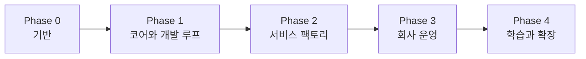

| 단계 | 범위 | 통과 조건 |
|---|---|---|
| Phase 0 기반 | Platform 하네스 최소판, STE-KO 규칙, LOC 검사기, 모듈 매니페스트 스키마, 저장소·CI 구성, 샌드박스 확인 | LOC 검사기가 CI에서 위반 PR을 막는다. 매니페스트 스키마 검사가 동작한다. |
| Phase 1 코어와 개발 루프 | Control Plane, 작업 상태 머신, Module Registry(`owns` 검사 포함), HITL Gateway(L0~L2), Project Orchestrator 최소판, Memory(Knowledge·Wiki 저장·검색), Core Services(설정 감사, 예산 라우터, 평가 관리 최소판), 모듈 8개: PM·기획·설계·서버·프론트엔드·QA·보안·재무(비용 원장) | 프로젝트 1개에서 PRD → ADR/Spec → 구현 → QA 검증 → 병합을 승인 관문과 함께 끝낸다. |
| Phase 2 서비스 팩토리 | Platform Orchestrator, 프로젝트 생성 템플릿, 디자인 시스템(HTML SSOT·토큰 내보내기), 연동 관리, 모듈: UI/UX·앱·DBA·DevOps·브랜딩·사업·법무·개인정보·릴리스 관리·AI 기능, HITL L3, Founder Console | 새 프로젝트를 하루 안에 준비한다. 기준 서비스 1개를 법무 문서와 함께 배포하고 되돌린다. |
| Phase 3 회사 운영 | 마케팅·데이터 분석 모듈, 다중 프로젝트 운영, 회사 주간 보고, 하네스 동기화 | 프로젝트 2개 이상을 동시에 운영한다. 주간 보고가 자동으로 나온다. |
| Phase 4 학습과 확장 | Dreaming, 벡터 검색, 하네스 자동 개선 후보, CS 모듈 | Dreaming 후보의 승인율을 측정한다. 하네스 개선이 평가 점수를 올린다. |

첫 개발 대상은 Flywheel 자체다. Platform은 Phase 1부터 자기 자신의 개발에 쓴다(dogfooding). 이 원칙은 이전 설계 [ADR-0008](draft/adr/0008-platform-first.md)과 같다.

## 17. 위험과 대응

| ID | 위험 | 영향 | 대응 |
|---|---|---|---|
| R-01 | 범위가 너무 넓다. 모듈이 24개다. | 플랫폼을 완성하지 못한다. 기존 문제(PB-01~04)가 반복된다. | 단계별로 모듈을 나눈다. Phase 1은 8개 모듈만 만든다. 나머지는 매니페스트와 빈 껍데기만 둔다. 새 기능은 먼저 기존 모듈의 책임으로 넣는다(§6.4). |
| R-02 | 에이전트가 잘못된 변경을 병합한다. | 서비스 품질 저하, 보안 사고 | 병합·배포 권한을 에이전트 밖에 둔다. HITL L2·L3를 강제한다. |
| R-03 | 오염된 지식이 규칙이 된다. | 잘못된 규칙이 모든 프로젝트에 퍼진다. | 신뢰 등급, 증거 조건, 사람 승격만 허용한다. |
| R-04 | AI 비용이 커진다. | 재무 부담 | 재무 모듈의 예산 원장을 Phase 1에 넣는다. 작업별 상한을 둔다. |
| R-05 | 승인 요청이 너무 많다. | 창업자 시간 부족, 승인 피로 | 관문 수준을 측정하고 조정한다. 묶음 승인을 지원한다. KPI-03을 본다. |
| R-06 | 외부 도구(Claude Code 등)의 동작이 바뀐다. | Hook, 어댑터 고장 | Harness Adapter로 감싼다. 버전별 계약 시험을 둔다. |
| R-07 | LOC 규칙이 품질을 해치는 분리를 만든다. | 의미 없는 작은 함수가 는다. | 리뷰 에이전트가 분리의 질을 본다. 예외 주석을 허용한다. |
| R-08 | HTML SSOT를 네이티브 앱에 옮기기 어렵다. | 플랫폼별 디자인 차이 | 토큰만 자동 내보낸다. 컴포넌트는 플랫폼별로 구현하고 시각 회귀로 비교한다. |
| R-09 | 모듈 책임이 겹친다. | 에이전트가 같은 산출물을 다르게 만든다. 정본이 둘이 된다. | 산출물마다 소유 모듈을 하나만 둔다(§6.6). Registry가 중복 소유를 거부한다. |
| R-10 | AI가 만든 법무 문서를 그대로 게시한다. | 법적 분쟁, 스토어 심사 거절 | 법무 문서는 "초안"으로 표시한다. 고위험 쟁점은 외부 전문가 확인 후 게시한다(HITL L3). |

## 18. 결정이 필요한 사항

| ID | 질문 | 기본값 (제안) |
|---|---|---|
| Q-01 | 창업자의 주당 가용 시간은 얼마인가? | 이전 설계의 주 20시간 |
| Q-02 | 이전 상세 설계([draft/](draft/README.md))를 어디까지 이어 쓰는가? | 보안 경계, 승인, Memory 승격 결정은 이어 쓴다. 모듈 구조는 이 계획서를 따른다. |
| Q-03 | 명령어 이름은 `fw`인가, 이전 설계의 `ax`인가? | `fw` (제품명 Flywheel과 맞춘다) |
| Q-04 | Platform 구현 언어는 TypeScript인가? | TypeScript |
| Q-05 | 첫 기준 서비스는 무엇인가? | Phase 2 시작 전에 사업 모듈로 정한다. |
| Q-06 | 월 AI·인프라 예산 상한은 얼마인가? | 미정. Phase 0에서 정한다. |
| Q-07 | 로컬 단일 머신에서 시작하는가? | 예. 이전 설계 [ADR-0001](draft/adr/0001-local-control-plane.md)과 같다. |
| Q-08 | LOC 계산에 빈 줄과 주석을 넣는가? | 넣지 않는다. 시그니처부터 닫는 괄호까지 실행 줄만 센다. |
| Q-09 | 법무 문서의 외부 전문가 검토는 어느 경우에 받는가? | 결제, 민감정보, 위치정보, 아동 대상 서비스는 반드시 받는다. |
| Q-10 | AI 기능 모듈의 기본 모델 공급자는 무엇인가? | Claude API. 비교 평가 후 서비스별로 바꿀 수 있다. |

## 19. 이전 설계와의 관계

저장소의 `draft/` 폴더에는 이전 요구 문서로 만든 상세 설계 v1이 있다. 이 계획서는 새 요구 문서([request-draft.md](request-draft.md))를 기준으로 한다.

| 이전 설계 | 이 계획서에서의 처리 |
|---|---|
| 신뢰 경계, Hook은 경계가 아니다 (ADR-0002) | 이어 쓴다 (§5.2) |
| 사람이 승격하는 학습 (ADR-0003) | 이어 쓴다 (§10.3) |
| 패스키 승인 (ADR-0006) | HITL L3로 이어 쓴다 (§9.3) |
| 기업 기능 모듈 (ADR-0010, 14장) | Company 모듈 9종으로 다시 정리한다. 법무·개인정보는 새 모듈로, 수익화·자산·회사 운영은 기존 모듈의 책임으로 넣는다 (§6.1, §6.4) |
| 역할 A13 QA, A16 AgentShield 감사 | QA 모듈과 에이전트 설정 감사(Core Services)로 이어 쓴다 (§6.2, §6.5) |
| 서비스 Type A~D 팩 | 스택 팩과 프로젝트 템플릿으로 다시 정리한다 (§7.3) |
| 피드백 루프 (ADR-0013) | 3개 층 루프로 확장한다 (§9.2) |
| 로드맵 P0~P3 | Phase 0~4로 다시 나눈다 (§16) |

## 부록 A. 요구사항 추적표

| request-draft.md 항목 | 계획서 위치 |
|---|---|
| 컴퍼니 모듈 8종 | §6.1 |
| 프로젝트 모듈 9종 | §6.2 |
| (검토 후 추가) 모듈 4종, 책임 이관, Core Services, 모듈 경계 | §6, §6.4~§6.6 |
| Memory 모듈 3종 | §6.3, §10 |
| AI Native Platform·Management Tool | §4, §5, §8 |
| Platform 성장형 하네스 | §11 |
| 프로젝트 성장형 하네스 | §11 |
| Memory 서비스 | §10 |
| 모듈 추가·제거·활성화·비활성화 | §7 |
| Feedback Loop와 HITL | §9 |
| Platform·Project Orchestrator | §8 |
| STE-KO 문서와 다이어그램 | §15 |
| HTML 디자인 SSOT, Atomic, 프로젝트 팔레트 | §12 |
| Clean Architecture, DDD(선택) | §13.1, §13.2 |
| 함수 25/50 LOC 규칙 | §13.3 |

## 부록 B. 다음 작업

1. 창업자가 §18의 결정 사항에 답한다.
2. 이 계획서를 검토하고 v0.3으로 고친다.
3. Phase 0의 상세 작업 목록과 시간을 산정한다.
4. 모듈 매니페스트 JSON Schema와 LOC 검사기를 먼저 만든다.
